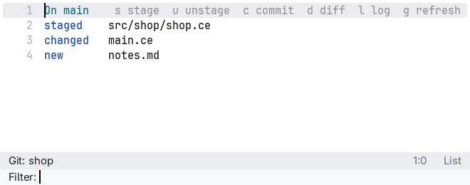
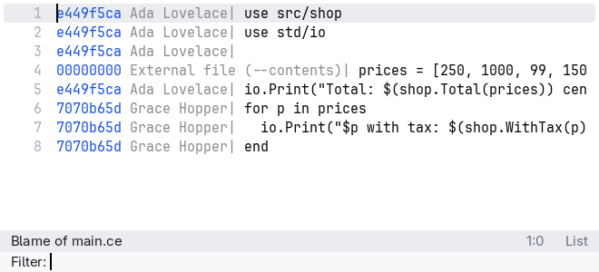

# Git

Git keeps the history of a project: each *commit* is a state of its files with a message, and the *index*, which Git also
calls the staging area, holds what the next commit will take. Cemacs has a small part of what Magit, the Git client of
Emacs, does: the state of the repository, where one letter stages a file, unstages it or commits, the log, a commit, the
diff of a file and the commit of each line. These keys are those of [src/ide], which asks `tools/git.ce`, with [src/git],
at each key: [Names](names.md#how-the-ide-asks) tells how.

## Keys

| Keys | Command | What it does |
|---|---|---|
| `C-x g`, `C-c g g` | [ide.Status] | lists the state of the repository of the file: its branch, then the files staged, changed and new |
| `C-c g l` | [ide.Log] | lists the last 500 commits, the last first; Enter shows one |
| `C-c g b` | [ide.Blame] | lists the lines of the buffer, each with the commit that last changed it and its author |
| `C-c g d` | [ide.Diff] | shows what changed in the file of the buffer, as saved, since what is staged of it |

`C-x g` is the key of Magit, and `C-c g g` the place of Git in Doom Emacs, `SPC g g`. The repository is the one that holds
the file of the current buffer, or the folder where Cemacs started.

## The state

`C-x g` opens a list: the first row names the branch and the letters, `On main    s stage  u unstage ...`, then one row for
each file, `staged`, `changed` or `new` before its path from the root of the repository. A file staged and changed since
has a row of each. In this list, as in Magit, a letter is a command, where typing filters the other lists of Cemacs: the
state has few rows, and a letter is the fastest way to each thing.

| Letter | What it does |
|---|---|
| `s` | stages the file of the row: `git add -- PATH` |
| `u` | unstages it: `git restore --staged -- PATH` |
| `c` | asks `Commit message: `, then commits what is staged: `git commit -q -m MESSAGE` |
| `d` | shows the diff of the file of the row: what is staged of it, or what changed since, for a row `changed` |
| `l` | lists the log, as `C-c g l` |
| `g` | lists the state again, after a change made elsewhere |

Enter opens the file of the row, and any other letter says the letters. After `s`, `u` or `c`, the state shows again, the
cursor on the same row. A message is one line, as the prompt line takes one: the owner of a project that writes a line of
subject only, as Cesia's and Cemacs's own commits, needs no more.

## Diffs, the log and the blame

A diff is a list of the lines `git diff` writes, the added lines in the colour of texts, the removed ones in that of
keywords, the lines that start a part, `@@ -1,2 +1,3 @@`, in that of comments. Enter on a line of the new side, added or
kept, opens the file at that line. `C-c g l` lists `HASH  DATE  AUTHOR  SUBJECT` for each commit; Enter shows it as `git
show --stat --patch` does, its words, the files it changed and its diff, as a list. `C-c g b` gives git the text of the
buffer, not saved too, through `git blame --contents -`, so that each line shows the commit and the author that last
changed it, `00000000` for a line not committed yet; the list opens on the line of the cursor, and Enter shows the commit of
the line.

![The diff of main.ce after C-c g d: the header of git diff, the part @@ -1,7 +1,7 @@, the removed line prices = [250, 1000, 99] and the added line prices = [250, 1000, 99, 1500], with the lines kept around them.](images/git-diff.png)

## Security

git runs as `sys.Run("git", ["-C", ROOT, ...])`: no shell reads the line, each word is one argument, a path comes after `--`
and a message after `-m`, so a file named `--oops.ce` stays a file and a message `--amend` stays a message, as the check of
this app tests. A hash given back to git, from the log or a blame, is checked to be one, letters `0` to `9` and `a` to `f`,
before it is. A git that runs more than 20 seconds is ended, and a list holds 20,000 rows at most.

A folder can bring its `.git/` with it, from an archive, a USB stick or a shared folder, and git reads the config of that
`.git/` at each run, where a key can name a program: `core.fsmonitor` runs at each read of the index, `diff.external` and a
diff driver's `textconv` at each diff, a filter's `clean` at each read of a changed file, a hook at each write of the index,
`gpg.program` for a signed commit, and a fetch, which a partial clone makes for an object it lacks, runs `core.sshCommand`,
the helper of `remote.NAME.vcs` and more. So [src/gitrun] runs each git of Cemacs with `-c core.fsmonitor=false -c
diff.external=`, each diff with `--no-ext-diff --no-textconv`, and each git that only reads, the state, the diffs, the log,
`show`, the blame, `ls-files` and `grep`, also with no hook, no signature checked, no submodule diffed or searched by a git of
its own, and no gc. It first asks `git config --show-scope` which filters and keys of a fetch the repository's own config
sets: each such filter gets the value of your own config back, git-lfs's for one, or none; and a key of a fetch there means
that this git fetches nothing, so a partial clone whose config is plain still fetches what it lacks. `s` and `c` stage and
commit as `git add` and `git commit` do from a terminal: the hooks and the filters of the repository run, as they are its
own.
