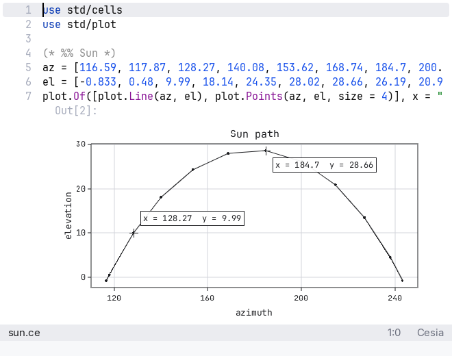
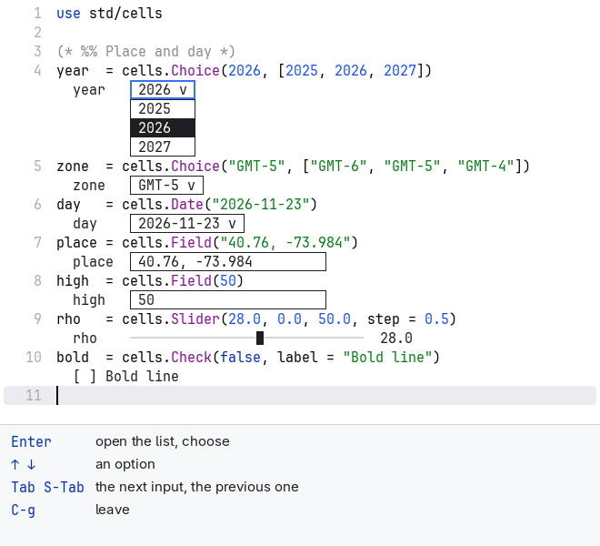
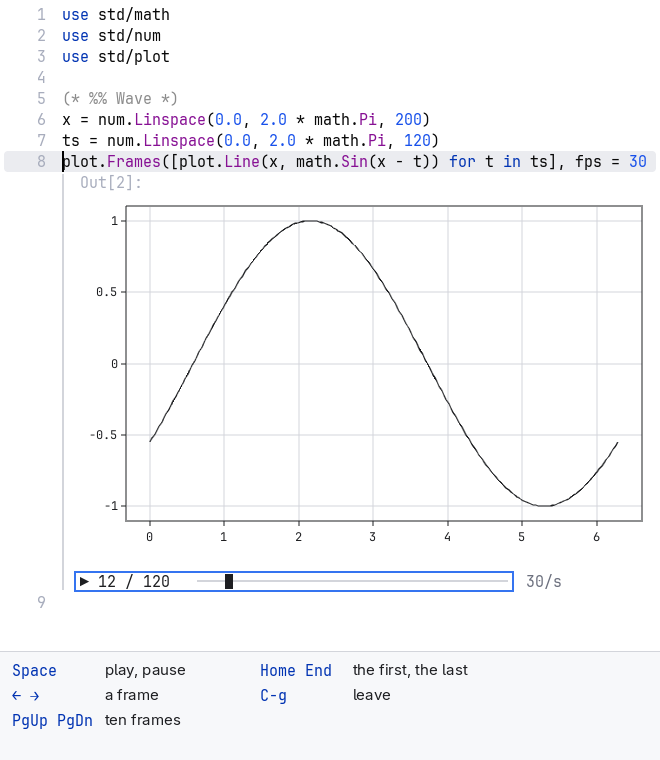
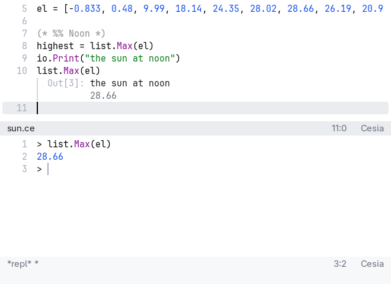
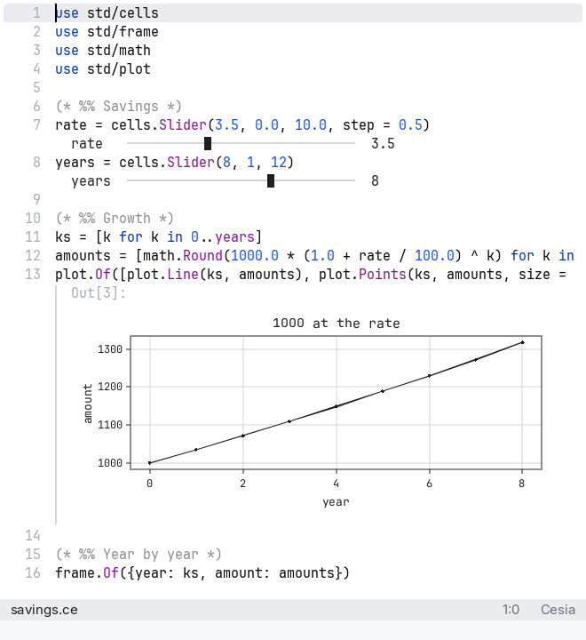
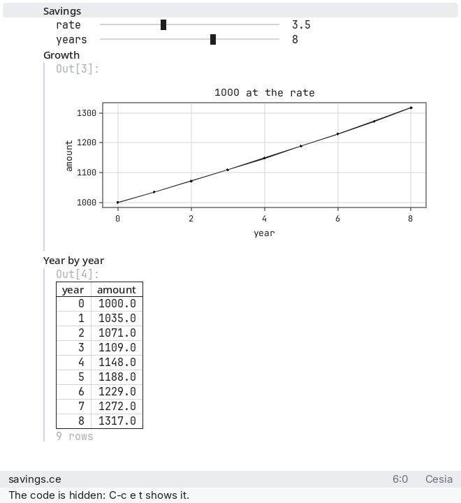

# Cells et résultats

Un fichier de Cesia coupé en *cells* (des cellules : des morceaux de code qui tournent chacun à part) tourne comme un
notebook (un carnet où le code alterne avec ses résultats) : chaque cell tourne seule, et son résultat s'affiche sous elle,
dans le buffer. Une cell commence à une ligne qui ne contient qu'un commentaire commençant par `%%`, comme
`(* %% Data *)` ; les lignes avant la première sont la première cell, en général les uses. Taper `%%` au début d'une
ligne vide écrit ce marqueur, `(* %%  *)`, le curseur là où va son titre, et undo (annuler) redonne `%%` ; dans un texte ou
un commentaire, rien ne se passe. `*scratch*` prend des cells comme un fichier. Le fichier reste un programme :
`cesia run` le lance depuis le haut et calcule ce que les cells montrent. Le moteur est
[std/cells](https://www-celestial.github.io/cesia-lang/cells.html) de Cesia, dont le chapitre dit les règles ; ce chapitre
dit ce que Cemacs en fait. Les cells sont une app de Cemacs, [src/notebook].

```cesia norun
use std/io
use std/list

(* %% Data *)
n = 1000
xs = [i * i for i in 1..n]

(* %% Mean *)
io.Print("mean of $n squares")
list.Mean(xs)
```

## Les touches

Les touches des cells sont un groupe de `C-c`, `e` pour *execute* (exécuter), que la bande des hints (la bande qui montre
à quoi mène une touche) montre comme elle montre les autres :

| Touches | Commande | Ce qu'elle fait |
|---|---|---|
| `C-c e e` | [notebook.RunCell] | lance la cell du curseur, puis chaque cell qui lit, directement ou par d'autres, un nom qu'elle définit |
| `C-c e a` | [notebook.RunAll] | lance toutes les cells, depuis le haut |
| `C-c e i` | [notebook.InsertCell] | écrit un marqueur, `(* %%  *)`, au-dessus de la ligne du curseur, le curseur là où va son titre |
| `C-c e v` | [notebook.ShowVariables] | ouvre `*variables*` à côté : les noms que les cells ont définis |
| `C-c e r` | [notebook.RunInRepl] | exécute la ligne du curseur, son bloc ou la sélection dans `*repl*` en dessous, dans la session des cells ; sur une ligne vide ou un commentaire, ouvre `*repl*` |
| `C-c e s` | [notebook.StopCell] | arrête la cell ou le code qui tourne, depuis le buffer ou depuis `*repl*` ; les cells qui attendent après elle ne tournent pas. Quand un graphe a les touches, enregistre plutôt le graphe en SVG, voir [La souris et les touches sur un graphe](#la-souris-et-les-touches-sur-un-graphe) |
| `C-c e h` | [notebook.WriteHtml] | écrit la page du fichier à côté de lui, `name.html` |
| `C-c e k` | [notebook.ClearResults] | efface les résultats dessinés ; les noms de la session restent |
| `C-c e f` | [notebook.FocusControl] | donne les touches au premier input de la cell du curseur, un slider ou un autre, à la barre de son animation, à son graphe 3D, à sa table ou à son graphe : voir Sliders, Inputs, Animations, Graphes 3D, Tables et Les graphes |
| `C-c e c` | [notebook.CopyTable] | copie une table en CSV : celle qui a les touches, ou les a eues en dernier, ou la première de la cell du curseur |
| `C-c e t` | [notebook.ToggleCode] | cache le code de tout le fichier, qui se montre comme une petite app, ou le montre à nouveau : voir [La vue d'une app](#la-vue-dune-app) |

Dans `*repl*`, Enter lance ce qui a été tapé, et `M-p` et `M-n` reculent et avancent dans ce qui a été tapé avant ;
partout ailleurs, Enter est un saut de ligne, comme toujours.

## Les résultats sous une cell

Un résultat est dessiné sous la dernière ligne non vide de sa cell, après une fine barre : ce que la cell a affiché, puis
sa valeur, ou son erreur en rouge avec sa ligne, comme `cesia run` la montre. Un graphe de
[std/plot](https://www-celestial.github.io/cesia-lang/graphs.html) est dessiné, haut de 400 pixels et aussi large que le pane (la partie de la fenêtre qui montre un buffer). Une frame (un tableau de données en colonnes), une matrice, une liste de maps ou de structs et
un struct s'affichent comme une table, comme le dit [Tables](#tables), une liste comme ses premières valeurs, toute autre
valeur comme son texte. Une cell qui tourne montre
`running…` (en cours) et les secondes écoulées ; les cells qui la suivent dans la file montrent `waiting` (en attente). Une
cell qui n'a rien affiché et ne donne aucune valeur ne dessine rien. Chaque partie est coupée à 40 lignes, la dernière
disant combien il en reste.

Chaque résultat commence par son étiquette, comme dans Jupyter : `Out[3]:` sur sa première rangée, en gris, les lignes du
résultat après elle et alignées dessous, pour que ce qu'une cell a donné se distingue de son code. Le nombre compte les
lancements de la session, celui-ci compris, et repart de 1 avec une nouvelle session ; un résultat qui commence par un
graphe a l'étiquette sur une rangée à elle, au-dessus du graphe. Un état comme `running…` reste au-dessus de l'étiquette,
et `*repl*` écrit ses réponses sans.

Une cell montre plus que sa dernière valeur avec `cells.Show` de
[std/cells](https://www-celestial.github.io/cesia-lang/cells.html), comme `display` dans Jupyter : chaque valeur qu'elle
montre vient à sa place parmi ce que la cell affiche, un graphe, une table, une matrice ou un texte, puis la valeur de la
dernière expression vient en dernier. Deux graphes et une ligne entre eux :

```cesia norun
use std/cells
use std/io
use std/plot

(* %% Two graphs *)
cells.Show(plot.Line([1, 2, 3], [1, 4, 9]))
io.Print("then the other")
plot.Line([1, 2, 3], [9, 4, 1])
```

Chaque graphe est dessiné à la largeur du pane et redessiné quand elle change, une animation a sa propre barre et un graphe
3D tourne seul ; `C-c e f` donne les touches au premier de la cell. `*repl*` les dessine dans le même ordre, et la page de
`C-c e h` aussi.

Un résultat n'est pas du texte : le curseur n'y entre jamais, il n'est jamais enregistré, et une modification ne peut pas
le toucher. Il bouge avec les lignes de sa cell quand vous tapez au-dessus ou dedans, et une demi-seconde après la dernière
touche, il revient sous la dernière ligne de sa cell. L'écran, la souris et le curseur comptent ses rangées : une page
montre moins de lignes quand des résultats y prennent de la place.

## Les graphes

Une cell dont la dernière expression est un graphe, comme `plot.Line(t, y)` ou `plot.Of([...])`, le montre sous son code.
La session calcule sa *scene* (sa scène), les formes du graphe en pixels à la largeur du pane, et Cemacs dessine la scene :
ses lignes aux bords adoucis, ses aires, ses barres, ses marques et ses cases, et ses textes en Noto Sans Medium, la police
avec laquelle std/plot les a mesurés, sans kerning, l'ajustement de l'espace entre deux lettres, et sans hinting (le
calage des lettres sur la grille des pixels), si bien que chaque texte prend la largeur que std/plot lui a donnée. Les
axes, la grille et les textes prennent les couleurs du thème ; les données gardent les leurs. Quand le pane change de
largeur, la session dessine à nouveau la scene à la nouvelle ; le graphe garde sa forme jusqu'à ce qu'elle arrive.
`*repl*` dessine un graphe sous sa réponse de la même façon, et la page de `C-c e h` contient chaque graphe en SVG.
L'écran glisse sur un graphe une rangée à la fois, sa partie basse visible quand l'écran commence dedans : voir
[L'écran d'un pane](windows.md#lécran-dun-pane).

![La cell Sun de sun.ce après C-c e a : sous son code, Out[2]: et le graphe Sun path dessiné dans la page, une ligne par 12 points d'azimut et d'élévation, noir sur blanc comme dans le thème clair.](../../book/images/cells-graph.png)

### La souris et les touches sur un graphe

Un graphe à deux dimensions, ni une animation ni un graphe 3D, montre les valeurs de ses points, comme la page de
SunEarthTools les montre sous la souris.

- **La souris au-dessus.** Le point le plus proche de la souris, à 12 pixels près, de ses lignes, de ses points et de ses
  textes, montre une croix fine et ses valeurs dans une petite case à côté, `x = 128.27  y = 9.99`, dans les unités des
  données, sur un axe log aussi, comme std/plot écrit la case d'une marque : 6 chiffres significatifs au plus, après le
  label de sa layer, `21 Jun: x = …`, quand le graphe en a plus d'une. Rien n'est dessiné quand aucun point n'est aussi
  près.
- **Un clic sur un point** épingle sa case : elle reste, et plusieurs le peuvent ; un clic de nouveau sur elle, ou
  `Escape`, l'enlève. Le clic donne aussi les touches au graphe, comme un clic sur une table, et choisit sa rangée dans une
  table de la cell qui a autant de rangées, comme le dit [Une rangée et son point](#une-rangée-et-son-point). Un appui sur
  les lignes au-dessus du graphe va au texte, comme avant.



La première fois que la souris passe sur un graphe, ou que le graphe prend les touches, sa scene est demandée de nouveau,
une fois, [cells.Scene](https://www-celestial.github.io/cesia-lang/cells.html) avec `points = true`, qui donne les places et
les valeurs des points que le graphe dessine, ceux que M4 (l'algorithme qui allège une longue ligne) garde d'une longue
ligne, et comment ses axes rencontrent les pixels ; le graphe garde les formes qu'il a dessinées. Ensuite, un mouvement de
la souris ne demande rien : les points sont rangés dans des buckets (des cases de rangement) de 32 sur 32 pixels, et le
plus proche est trouvé parmi ceux des buckets que touchent les 12 pixels autour de la souris, quatre au plus.

`C-c e f` dans sa cell, quand la cell n'a pas d'autre contrôle, Tab depuis une table de la cell, ou un clic donne les
touches au graphe : un anneau de la couleur d'accent l'entoure, et le point des touches a sa croix et sa case dans cette
couleur.

| Touches | Ce qu'elles font |
|---|---|
| `←` `→` | le point d'avant, le point d'après, le long de sa layer, et sa rangée dans une table de la cell |
| `↑` `↓` | la layer d'avant, la layer d'après, au point de la position la plus proche |
| `Space` | épingle le point des touches, ou le désépingle |
| la molette | zoome autour de la souris, un cran vers le haut 20 % plus près |
| un glissement | déplace la vue, ce qui est sous la souris la suivant ; pas dans un graphe polaire |
| `0` | revient aux étendues du graphe lui-même |
| `M-w` | copie les valeurs des points épinglés, une ligne chacun, x et y séparés par une tabulation, ou sans épingle celles du point des touches |
| `C-c e s` | enregistre le graphe en SVG à côté du fichier |
| `Tab` `S-Tab` | la table ou le graphe suivant de la cell, le précédent |
| `Escape` | enlève les épingles ; sans épingle, quitte le graphe |
| `C-g` | quitte le graphe |

**Le zoom.** Chaque cran de la molette change les étendues voulues et demande à la session la scene à ces étendues,
[cells.Scene](https://www-celestial.github.io/cesia-lang/cells.html) avec `xlim` et `ylim`, comme les options de
`plot.Of` les donnent : la session la dessine, ses graduations et leurs étiquettes refaites, et les points sous la souris
viennent avec elle. La valeur sous la souris reste sous elle. Une question à la fois : les crans qui viennent pendant
qu'une question attend ne changent que les étendues voulues, et les dernières sont demandées une fois la réponse venue,
si bien qu'une molette rapide ne demande pas une file de vues anciennes. Un axe des noms de barres garde sa propre
étendue, et un graphe polaire ne zoome que la distance à son centre, son `ylim`, `[center, rim]` (le centre, le bord).
Un zoom reste entre un millionième et un million de fois l'étendue du graphe lui-même. Le code ne change jamais : `0`,
un lancement de la cell et la page montrent le graphe comme son code le dessine.


**Sans les touches, rien ne change.** Tant qu'aucun graphe n'a les touches, la molette au-dessus d'un graphe déplace
l'écran, comme elle l'a toujours fait, un glissement dessus ne zoome rien, et chaque touche fait ce qu'elle faisait : `0`
s'écrit, `M-w` copie la région, `C-c e s` arrête la cell qui tourne.

**Le SVG.** `C-c e s` écrit le graphe comme son code le dessine, à sa propre taille et à ses propres étendues, le texte que
`plot.Save` écrirait, que [cells.Svg](https://www-celestial.github.io/cesia-lang/cells.html) demande à la session ; un zoom
est une vue de l'éditeur et n'y est pas, comme la vue vers laquelle on a tourné un graphe 3D. Le fichier va à côté du
fichier des cells, nommé d'après lui et le titre de la cell en minuscules et en chiffres, ses accents enlevés,
[notebook.SvgPath] : `sun-day.svg` pour le graphe de la cell `(* %% Day *)` de `sun.ce`, `sun-day-2.svg` pour un second
graphe de cette cell, `sun-cell3.svg` pour une troisième cell sans titre. Un fichier ou un lien qui est déjà là fait
l'objet d'une question d'abord, comme pour la page, et le fichier est écrit comme un enregistrement en écrit un, par un
nouveau fichier et un rename, si bien qu'un lien là est remplacé, jamais écrit à travers.

## Tables

Une frame, une matrice, une liste de maps ou de structs et un struct s'affichent comme une *table* (un tableau) sous leur
cell, dessinée comme la page de SunEarthTools dessine ses tables : des bords fins, une rangée d'en-tête dans la police
forte, les nombres à droite de leur colonne, chaque point décimal sous ceux des autres, les textes à gauche, dans la police
du code, à l'encre du thème sur son papier. Le cadre de la table et le trait sous son en-tête sont à l'encre, les lignes
entre les rangées et les colonnes dans la couleur des lignes ; une ligne sous la table dit ses rangées,
`rows 21–40 of 1000000`, les mots de son filtre et son tri.

Une table montre 20 rangées au plus. Une plus longue défile dans son bloc : la molette au-dessus d'elle la déplace de trois
rangées par cran, et à sa première ou à sa dernière rangée la molette déplace de nouveau l'écran. Ses rangées viennent de
la session cent à la fois, autour de celles qui se voient, par `cells.Rows` de
[std/cells](https://www-celestial.github.io/cesia-lang/cells.html) : la valeur ne quitte jamais la session, si bien qu'une
frame d'un million de rangées s'ouvre comme une de vingt, et qu'un écran d'elle coûte un écran. Le texte d'une case est
coupé à 40 caractères, le dernier `…` ; une table plus large que le pane montre les colonnes qui tiennent, à partir de
celle du curseur.

`C-c e f` dans sa cell, Tab depuis une autre table de la cell, ou un clic sur elle donne les touches à la table, comme un
input les a : un anneau de la couleur d'accent l'entoure, la case du curseur a un cadre de cette couleur, et la rangée
choisie est en inverse, l'encre et le papier échangés.

| Touches | Ce qu'elles font |
|---|---|
| `←` `→` `↑` `↓` | le curseur d'une case ; la rangée du curseur est la rangée choisie |
| `PgUp` `PgDn` | un écran, 20 rangées, le curseur là où il était sur l'écran |
| `Home` `End` | la première rangée, la dernière |
| `s` | trie par la colonne du curseur, en croissant ; de nouveau, en décroissant ; de nouveau, comme elle est donnée. Un clic sur un en-tête fait de même |
| `/` | un filtre : les mots tapés gardent les rangées qui contiennent chacun d'eux, dans n'importe quelle colonne, dans n'importe quel ordre, ses lettres ASCII en majuscule comme en minuscule ; il s'applique pendant la frappe, Enter le garde, Escape le retire |
| `Enter` `e` | modifie la valeur de la case du curseur, dans le fichier, quand la table y est écrite : voir [Une valeur modifiée dans le fichier](#une-valeur-modifiée-dans-le-fichier). Un double clic sur une case fait de même |
| `<` `>` | rend la colonne du curseur plus étroite, plus large, d'un caractère : voir [La largeur d'une colonne](#la-largeur-dune-colonne) |
| `=` | rend la colonne du curseur aussi large que les valeurs qu'elle montre |
| `t` | montre la rangée des totaux, les sommes ; de nouveau, les moyennes, les plus petites valeurs, les plus grandes, les comptes, puis rien : voir [La rangée des totaux](#la-rangée-des-totaux) |
| `M-w` | copie le texte de la case du curseur |
| `C-u M-w` | copie la rangée du curseur, ses cases séparées par des tabulations |
| `C-c e c` | copie toute la table en CSV (des valeurs séparées par des virgules), comme std/csv l'écrit : son en-tête, puis ses rangées comme elle les montre, triées et filtrées, 100 000 au plus |
| `Tab` `S-Tab` | la table ou le graphe suivant de la cell, le précédent |
| `Escape` `C-g` | quitte la table |

Le tri et le filtre se font dans la session, qui garde l'ordre pour l'écran suivant : les nombres se trient comme des
nombres, NaN (*not a number*, la valeur d'un calcul qui n'a pas de résultat) et les valeurs manquantes à la fin dans les
deux sens, et les rangées de valeurs égales gardent leur ordre. Une rangée choisie reste choisie quand la table est triée
de nouveau ou filtrée, à sa nouvelle place, tant que le filtre la garde. Tant qu'aucune table n'a les touches, chaque
touche fait ce qu'elle faisait : `s`, `/`, `e`, `<`, `>`, `=` et `t` s'écrivent dans le buffer, Enter commence une
nouvelle ligne, `M-w` copie la région.

### Une valeur modifiée dans le fichier

La règle des inputs (des champs du formulaire) vaut pour les tables : le fichier dit la vérité. Une valeur d'une table se
modifie là où le fichier l'écrit, jamais dans la session seule, pour que la prochaine exécution, `cesia run` et la page la
montrent aussi. Une table se modifie quand le fichier l'écrit en valeurs, comme
[cells.Tables](https://www-celestial.github.io/cesia-lang/cells.html#tables-written-in-the-file) les lit : une
liste de maps (de dictionnaires), `[{name: "Ana", age: 31}, {name: "Bo", age: 20}]`, ou `frame.Of` de listes, chaque
valeur un nombre, un texte, `true`, `false` ou `missing` écrit là, dans la cell de la table ou comme valeur d'un nom que sa
cell lit, et que la table montre ces valeurs, rangée pour rangée :

```cesia norun
use std/cells
use std/frame

(* %% Day *)
hours = frame.Of({hour: [7, 8, 9, 10, 11, 12], elevation: [0.48, 9.99, 18.14, 24.35, 28.02, 28.66]})
cells.Show(hours)
```

`Enter` ou `e` sur la case de `9.99`, ou un double clic dessus, l'ouvre : sa valeur telle que le fichier l'écrit, dans un
cadre de la couleur d'accent par-dessus la case, avec un curseur ; la bande d'aide montre `Enter` et `Escape`. La frappe
entre au curseur, `←` `→` `Home` `End` le déplacent, `Backspace` et `Delete` effacent. `Escape` ou `C-g` la retire, et le
fichier reste comme il était. `Enter` l'écrit : `10.5` prend la place de `9.99` dans le fichier, et seuls ces caractères
bougent, une seule étape d'annulation, `C-/` redonnant `9.99` ; puis la cell s'exécute de nouveau, avec les cells qui
lisent `hours`, comme après `C-c e e`, son dernier résultat en vue jusqu'à ce que le nouveau arrive. La nouvelle table
garde le tri, le filtre, le curseur, les largeurs et la rangée des totaux de celle qui a été modifiée, et les touches. Une
table triée ou filtrée se modifie à sa rangée telle qu'elle la montre : une rangée garde sa place dans la valeur, et cette
place est celle de sa valeur dans le fichier.

Le genre de la colonne dit ce qu'elle prend, comme le vérifie
[cells.Edit](https://www-celestial.github.io/cesia-lang/cells.html) : une colonne de nombres entiers un nombre entier,
une colonne de nombres n'importe quel nombre fini, écrit en Float (un nombre à virgule), `12` comme `12.0`, pour que la
colonne reste une colonne de Floats, une colonne de textes n'importe quel texte, écrit entre guillemets avec ses `"`, `\`
et `$` échappés, une colonne de `true` et `false` l'un des deux. Des mots d'un autre genre sont refusés, avec ce que la
colonne prend, comme `elevation takes a number: ten is none.`, et le cadre reste ouvert pour les changer. Une valeur qui
n'a pas changé n'écrit rien.

Une table qui vient du code, comme `frame.Of({hour: 7..16})`, une frame lue dans un fichier CSV ou
`frame.SortBy("x", hours)` quand son ordre diffère, n'a pas de valeur écrite à modifier : `Enter` le dit, et ne change
rien ; ses valeurs changent là d'où elles viennent. Pendant que sa cell s'exécute, une table se modifie une fois qu'elle
montre ce que le fichier écrit.


### La largeur d'une colonne

Une colonne est aussi large que sa plus large valeur, 40 caractères au plus, ou que son en-tête. Sa largeur peut se donner
à la main, de 1 à 40 caractères : `<` et `>` rendent la colonne du curseur plus étroite ou plus large d'un caractère, et
`=` la rend aussi large que les valeurs qu'elle montre à l'écran, son en-tête et son total. À la souris, un appui à 3
pixels près de la bordure à droite d'un en-tête, puis un glissé, déplace cette bordure ; un double clic là rend la colonne
aussi large que ses valeurs, comme `=`. Une colonne plus étroite que ses valeurs coupe chacune d'elles, et son en-tête, le
dernier caractère `…` ; un nombre qui tient reste à droite, son point décimal sous ceux des autres quand il y a la place
pour tous. La largeur est celle de l'éditeur, une vue de la table : elle ne s'écrit jamais dans le fichier, et reste tant
que la table se voit, après une modification aussi.

### La rangée des totaux

`t` montre une rangée sous les rangées, après un trait à l'encre : la somme de chaque colonne de nombres. De nouveau, `t`
montre leurs moyennes, puis leurs plus petites valeurs, leurs plus grandes, leurs comptes, puis plus de rangée ; une
colonne de textes, ou de `true` et `false`, montre combien de valeurs elle a, comme `5 values`. Les totaux comptent
chaque rangée que le filtre garde, pas seulement celles de l'écran :
[cells.Totals](https://www-celestial.github.io/cesia-lang/cells.html#totals) les calcule dans la session, sur les
colonnes entières de la valeur, si bien qu'une frame d'un million de rangées ne traverse jamais, et la ligne sous la table
dit ce qu'ils comptent, `Σ of 1000000 rows`. Les valeurs manquantes, `missing` et NaN, sont sautées, et comptées : la
ligne le dit, `Σ of 5 rows, 1 missing in temperature skipped`. Une somme s'écrit avec les décimales de sa colonne, une
moyenne avec deux de plus, la plus petite et la plus grande valeur comme la colonne les écrit. La rangée est redemandée
quand le filtre change, et pendant qu'elle est demandée elle montre `…`.


### Une rangée et son point

Dans les résultats d'une cell, une table de $n$ rangées et chaque ligne, points ou textes d'un graphe de $n$ points sont
liés par leur position, la rangée $i$ au point $i$, comme le dit
[std/cells](https://www-celestial.github.io/cesia-lang/cells.html) :

```cesia norun
use std/cells
use std/frame
use std/plot

(* %% Day *)
hours = frame.Of({hour: [7, 8, 9, 10, 11, 12], elevation: [0.48, 9.99, 18.14, 24.35, 28.02, 28.66]})
cells.Show(hours)
plot.Points(frame.Column("hour", hours), frame.Column("elevation", hours))
```

Une rangée choisie, par un clic ou les flèches, marque son point sur chaque graphe de la cell qui en a autant : un anneau
au point, à sa place exacte, même un point que le graphe a écarté en allégeant une longue ligne, et une case de ses
valeurs à côté, `x = 9  y = 18.14`, que la session dessine, une question pour chaque marque. Un clic sur un point d'un tel
graphe, à 12 pixels près, choisit sa rangée : la table défile jusqu'à elle, triée et filtrée comme elle l'est, et la
montre en inverse ; le graphe prend les touches, et ses flèches choisissent les rangées des points où elles vont. Une table
et un graphe de longueurs différentes ne sont pas liés, et rien n'est lié d'une cell à l'autre.


## Sliders

Un *slider* (un curseur) est une barre avec un bouton que l'on fait glisser pour changer un nombre. Une cell de sliders
ne contient que des lignes `name = cells.Slider(value, min, max)`, chacune avec ses nombres écrits là, comme
[std/cells](https://www-celestial.github.io/cesia-lang/cells.html) le demande :

```cesia norun
use std/cells
use std/ode
use std/result

(* %% Parameters *)
rho = cells.Slider(28.0, 0.0, 50.0, step = 0.5)

(* %% Lorenz *)
lorenz(t, y) = [10.0 * (y[2] - y[1]), y[1] * (rho - y[3]) - y[2], y[1] * y[2] - 8.0 / 3.0 * y[3]]
s = result.Unwrap(ode.Solve(lorenz, [0.0, 50.0], [1.0, 1.0, 1.0]))
```

Sous chacune de ces lignes, Cemacs dessine son slider, d'après le texte seul, avant que rien ne tourne : le nom, une piste,
un bouton, et le nombre tel que le fichier l'écrit. Un mouvement écrit le nouveau nombre dans le buffer, à la place de
l'ancien : le fichier dit ce que montre la fenêtre, et une fois qu'il est enregistré, `cesia run` et la page de `C-c e h`
lisent le même nombre. Le nombre bouge par steps (des pas), du min au max, et s'écrit avec les décimales du min et du
step, `0.3` et jamais `0.30000000000000004`.

- **La souris.** Un clic sur la piste y met le bouton, si bien qu'un seul clic suffit ; un glissé suit le pointeur. La
  molette fait défiler le buffer, comme partout, et ne fait jamais bouger un slider.
- **Les touches.** `C-c e f` donne les touches au premier slider de la cell du curseur, dessiné avec un anneau, et la
  bande des hints liste ses touches, telles que les donne le slider pattern de WAI-ARIA (les règles du W3C qui rendent un
  contrôle utilisable au clavier et par un lecteur d'écran) : `right` et `up` le font avancer d'un step, `left` et
  `down` reculer d'un step, `pageup` et `pagedown` de dix steps, `home` et `end` l'amènent à son min et à son max ; `tab`
  et `S-tab` vont au slider suivant de la cell et au précédent, en boucle. `C-g`, un clic dans le texte, une lettre tapée
  ou toute autre touche le quittent, et cette touche fait ce qu'elle fait toujours.
- **Undo.** Un glissé, du clic au relâchement, est une seule étape d'undo (l'annulation), et les touches pressées à la
  suite sur un même slider aussi, comme la frappe.


Un mouvement ne relance que les cells qui lisent le nom du slider, directement ou par d'autres cells : la session du
fichier reçoit le nouveau nombre par [cells.Set](https://www-celestial.github.io/cesia-lang/cells.html), *en place* (le
nom garde sa place, sans être défini de nouveau), si bien qu'une fonction d'une autre cell qui le lit le voit tout de
suite, et la cell du slider, qui ne contient rien d'autre, ne tourne pas. Sans session encore, le nombre est écrit et rien
ne tourne, et la prompt line dit que `C-c e a` lance les cells avec lui : le code d'un fichier, qui peut venir d'ailleurs, ne
tourne que quand vous le demandez, jamais sur un clic de la souris. Le bouton et le nombre suivent le pointeur tout de
suite ; les résultats suivent aussi vite que les cells tournent, et restent affichés jusqu'à ce que les nouveaux arrivent,
avec `waiting` ou `running…` au-dessus d'eux. Après le slider s'affiche le temps de son dernier rerun (sa dernière
relance), comme `rerun 104 ms`, pour que vous voyiez pourquoi un graphe est en retard.

**Le dernier nombre gagne.** Pendant que les cells d'un mouvement tournent, le slider ne garde que le dernier nombre vers
lequel on l'a bougé ; quand elles finissent, ce nombre est donné à la session et elles tournent une fois de plus. Deux
reruns d'un slider n'attendent jamais l'un derrière l'autre, rien n'est annulé, et un résultat ne vient jamais de deux
nombres.

**Les résultats périmés.** Un résultat calculé avec un autre nombre que celui que le fichier écrit maintenant le dit, sur
une ligne au-dessus de lui : `stale: computed with rho = 28.0` (périmé : calculé avec rho = 28.0). Cela arrive après que
`C-c e s` a arrêté un rerun, ce qui abandonne le nombre qui attendait, après un undo d'un mouvement, et après que vous
avez tapé un autre nombre à la main ; la ligne s'en va dès que la cell tourne de nouveau. Un nombre tapé à la main ne
lance rien par lui-même, comme toute modification : `C-c e e` le lance.

## Inputs

Les autres inputs (les champs) d'un formulaire s'écrivent comme un slider, un par ligne dans une cell d'inputs, chacun
avec sa valeur écrite là : une liste où choisir, une case à cocher, un champ où taper, et un jour, comme
[std/cells](https://www-celestial.github.io/cesia-lang/cells.html) les donne. Sliders et autres inputs partagent une
cell :

```cesia norun
use std/cells

(* %% Place and day *)
year  = cells.Choice(2026, [2025, 2026, 2027])
zone  = cells.Choice("GMT-5", ["GMT-6", "GMT-5", "GMT-4"])
day   = cells.Date("2026-11-23")
place = cells.Field("40.76, -73.984")
high  = cells.Field(50)
rho   = cells.Slider(28.0, 0.0, 50.0, step = 0.5)
bold  = cells.Check(false, label = "Bold line")
```

Sous chaque ligne, Cemacs dessine l'input à partir du texte seul, avant que rien ne tourne, dans la police du code, à
l'encre et sur le papier du thème, noir sur blanc dans le thème clair : son nom, puis sa case, ses bords larges d'un
pixel, avec sa valeur telle que le fichier l'écrit, et un `v` à droite d'une liste et d'un jour ; une case à cocher est
`[ ]` ou `[x]` suivie de son label (son libellé). Leurs noms s'alignent, et leurs cases aussi, avec les barres des
sliders.

```
year   [ 2026        v ]
zone   [ GMT-5       v ]
day    [ 2026-11-23  v ]
place  [ 40.76, -73.984           ]
high   [ 50                       ]
rho    ----------o--------  28.0
[ ] Bold line
```

`C-c e f` donne les touches au premier input de la cell du curseur, et un clic à l'input sous lui : sa case prend la
couleur d'accent, et la bande d'aide liste ses touches.



| Input | Touches | Souris |
|---|---|---|
| un choix | `enter` ouvre la liste, `up` et `down` s'y déplacent, `home` et `end` vont à la première option et à la dernière, `pageup` et `pagedown` de 8, `enter` choisit, `C-g` la ferme | un clic ouvre la liste, un clic sur une option la choisit |
| une case à cocher | `space` la coche, ou la décoche | un clic la coche, ou la décoche |
| un champ | ce que vous tapez va dans la case, `backspace` et `delete` effacent, `left`, `right`, `home` et `end` déplacent le curseur, `enter` le donne ; un champ de nombre ne prend qu'un nombre | un clic y met le curseur |
| une date | `left` et `right` choisissent l'année, le mois ou le jour, `up` et `down` le changent, le mois en tournant sur l'année et le jour dans son mois, `enter` la donne | un clic choisit la partie sous lui |

`tab` et `S-tab` passent à l'input suivant de la cell et au précédent, les sliders parmi eux, en tournant ; `C-g` en sort,
comme toute autre touche, qui fait alors ce qu'elle fait toujours. Aucune touche n'est prise tant qu'aucun input n'a les
touches : Entrée sur la ligne d'un choix est une nouvelle ligne, Espace une espace, comme partout.

Un changement écrit la nouvelle valeur dans le buffer à la place de l'ancienne, ses octets seuls, une étape d'annulation,
puis ne relance que les cells qui lisent son nom, tout de suite, comme le mouvement d'un slider : aucun bouton à presser.
Un champ attend `enter`, si bien que rien ne tourne à chaque lettre tapée, et une date aussi. Un texte s'écrit entre
guillemets, ses `"`, `\`, fins de ligne, tabulations et `$` échappés comme Cesia les lit, par
[cells.Snap](https://www-celestial.github.io/cesia-lang/cells.html) : ce que vous tapez arrive à la session comme ce
texte, et ne tourne jamais, même `$(...)`. Pendant que les cells tournent, une cell lourde affiche `running…` et `C-c e s`
l'arrête, comme pour un slider ; la dernière valeur gagne, et un résultat calculé avec une autre valeur que celle du
fichier le dit : `stale: computed with zone = GMT-5`. Sans session encore, la valeur est écrite et rien ne tourne, et la
ligne d'invite dit que `C-c e a` lance les cells avec elle.

## Animations

Une cell dont la dernière expression est une animation, comme
`plot.Frames([plot.Line(x, math.Sin(x - t)) for t in ts], fps = 30)` de
[std/plot](https://www-celestial.github.io/cesia-lang/graphs.html), montre sa première image, en pause, au-dessus d'une
barre :

```
  ▶ 12 / 120  ───────●──────────────────  30/s
```

`▶` quand elle est en pause, `‖` quand elle se joue, l'image montrée et leur nombre, une piste avec un bouton à l'image,
et le rythme. Elle démarre en pause, à chaque lancement de sa cell aussi, comme WCAG 2.2 (les règles du W3C pour des
pages accessibles) le demande de ce qui bouge plus de 5 secondes.

- **Les touches.** `C-c e f` dans sa cell donne les touches à la barre, dessinée avec un anneau, et la bande les liste :
  `space` (la barre d'espace) la joue ou la met en pause, `right` et `up` avancent d'une image, `left` et `down` reculent
  d'une image, `pageup` et `pagedown` de dix, `home` et `end` vont à la première image et à la dernière ; chacune de ces
  touches la met d'abord en pause. `C-g`, un clic dans le texte ou toute autre touche la quittent.
- **La souris.** Un clic sur `▶` la joue ou la met en pause ; un clic sur la piste va à l'image sous le pointeur, et un
  glissé le suit. Un clic sur le graphe ne fait rien.



**Une image à la fois.** Les images restent dans la session : Cemacs demande chacune par
[cells.Scene](https://www-celestial.github.io/cesia-lang/cells.html), `frame = k`, à la largeur du pane, pendant que
l'image d'avant se montre, et la garde jusqu'à son heure. Il y a donc au plus deux images dans la mémoire de Cemacs, et
une animation de 300 images ne traverse jamais en entier. Aucune image n'est sautée : chacune est un état de ce que vous
avez calculé, et une image en retard se montre en retard, pendant que la barre dit le rythme réel, comme `24/s of 30`
(24 par seconde sur 30). Après la dernière image vient la première, jusqu'à ce que vous la mettiez en pause.

**Seulement à l'écran.** Elle se joue tant que son graphe est à l'écran : défilée hors de vue, ou avec son buffer dans
aucun pane, elle attend là où elle est, et Cemacs ne prend aucun tick (aucun tour de la boucle d'affichage) pour elle ;
une animation en pause n'en prend pas non plus. Une cell qui tourne, ou le nombre d'un slider qu'on donne à la session,
passe avant l'image suivante, qui attend.

## Graphes 3D

Une cell dont la dernière expression est un graphe 3D, une surface de `plot.Surface`, des courbes de `plot.Line3` ou des
pièces de `plot.Mesh` de [std/plot](https://www-celestial.github.io/cesia-lang/graphs.html#3d), le montre à la vue que donne son code,
`view = [az, el]` ou le `[-37.5, 30]` de MATLAB, avec une ligne en dessous qui dit la vue (*view*) :

```
  view −62.5°, 20° (code −37.5°, 30°)
```

Le premier angle est l'*azimut*, le tour autour de l'axe vertical, et le second l'*élévation*, l'angle de l'œil au-dessus
du plan de x et y ; la ligne dit aussi la vue du code tant que le graphe en montre une autre.

- **La souris.** Un glissé sur le graphe le tourne comme si vous le teniez, 0,5° par pixel : vers la droite, son avant
  va à droite ; vers le bas, son dessus vient vers vous. Un clic sur le graphe lui donne aussi les touches.
- **Les touches.** `C-c e f` dans sa cell lui donne les touches, dessiné avec un anneau autour, et la bande les liste :
  les flèches déplacent votre œil de 10°, `right` et `left` autour du graphe, `up` et `down` plus haut et plus bas,
  jusqu'à la verticale au plus ; `home` revient à la vue du code. `C-g`, un clic dans le texte ou toute autre touche le
  quittent.

**Chaque vue est dessinée par la session.** Cemacs la demande par
[cells.Scene](https://www-celestial.github.io/cesia-lang/cells.html), `view = [az, el]` : std/plot y projette la surface,
comme il le fait pour la page, et seules les places de ses points à l'écran reviennent, avec l'ordre où dessiner ses
quads (ses quadrilatères) ; les couleurs des quads restent dans Cemacs tant que seule la vue change. Une question à la
fois : pendant qu'une est posée, un glissé ou une touche ne change que la vue voulue, que la ligne montre tout de suite,
et une fois la réponse venue, c'est la dernière vue voulue qui est demandée, si bien que le graphe suit la souris sans file
de vieilles vues. Rien n'est écrit dans le fichier : le code garde sa vue, la page la montre, et un lancement de la cell
la remontre. Pour garder la vue trouvée, écrivez les deux nombres de la ligne comme `view` de la cell.

### Tourner une pièce avec la souris

Un graphe de pièces solides, des boîtes, des cylindres et une pièce STL placés par std/mesh et dessinés par `plot.Mesh`,
comme les construit le chapitre [Objets 3D](https://www-celestial.github.io/cesia-lang/3d.html) du livre de Cesia, tourne
comme une surface :

```cesia norun
use std/cells
use std/mesh
use std/plot

(* %% A shaft through a block *)
block = mesh.Box([0, 0, 0], [40, 20, 10])
shaft = mesh.Move(mesh.Turn(mesh.Cylinder([0, 0, 0], 3, 60), [0, 1, 0], 90), [-10, 10, 5])
plot.Of([plot.Mesh(block, color = "#3cb043", edges = true), plot.Mesh(shaft, edges = true)], axes = false)
```

Glissez sur le graphe, ou faites `C-c e f` puis les flèches, et le bloc et l'arbre tournent ; `home` revient à la vue du
code. Quand le code ne donne pas de `light`, la lumière est une lampe au-dessus de votre œil : elle tourne avec vous, et
les faces tournées vers vous restent éclairées, comme dans un logiciel de CAO ; avec `light = [x, y, z]`, elle reste là où
le code la met, comme le soleil, et les pièces tournent dessous. L'arbre se voit là où il sort du bloc à chaque vue :
std/plot l'a coupé une fois, quand la cell a tourné.

Les pièces viennent comme un seul item de la scène, `triangles` : les places de leurs points, une couleur pour chaque
triangle, ombrée par la lumière, et les arêtes du dessin, chacune après le triangle qu'elle suit. Cemacs les dessine avec
`SDL_RenderGeometry`, une couleur à chaque sommet, dans l'ordre de la scène, les lointains d'abord. Une vue change les
places, les couleurs et l'ordre, donc l'item entier revient de la session à chaque vue. Avant qu'aucune mémoire ne soit
prise, il est vérifié : au plus 400 000 triangles et 600 000 arêtes, chaque coin un point de l'item, chaque couleur
`0xRRGGBB`, les arêtes dans l'ordre des triangles qu'elles suivent, leur largeur de 0 à 50 ; tout le reste est refusé, et
la cell dit pourquoi.

Un pas d'un glissé, de la souris à l'image, sous le driver dummy de SDL, qui dessine en logiciel : 28 ms pour la machine
du livre de Cesia, 516 triangles en six pièces ; 80 ms pour une boule de 16 128 triangles ; 0,30 s pour une de 99 224, la
plus grande part étant la vue de la session, 100 ms, et les triangles qui reviennent. Une pièce de quelques milliers de
triangles suit la souris ; une de 100 000 tourne à environ trois vues par seconde.

Un graphe 3D de `*repl*` tourne de la même façon, avec la session de son fichier. Un graphe 3D dans une grille ou dans une
animation ne tourne pas.

## Ce qui tourne à nouveau

`C-c e e` lit les cells du buffer tel qu'il est, ses changements non enregistrés aussi, et lance la cell du curseur et
celles qui en dépendent, dans l'ordre du fichier : une cell qui a changé et les cells qui utilisent ce qu'elle calcule. Les
autres cells gardent leurs résultats. La première cell, celle des uses, les lance toutes. Une cell qui enfreint une règle
des cells, comme un nom défini dans deux cells ou un nom lu avant sa cell, montre cette erreur à la place d'un résultat, et
ne tourne pas. Une cell qui tourne à nouveau refait ce qu'elle fait en plus de sa valeur : elle affiche à nouveau, et écrit
à nouveau ses fichiers.

## La session

Chaque fichier de cells a une *session* : un processus Cesia, `cesia run --cells`, qui garde les noms que ses cells ont
définis, si bien qu'une cell tourne sans que celles d'avant tournent à nouveau. Elle démarre à la première cell lancée, avec
les permissions de la tâche de `cesia.toml` qui lance le fichier, comme `C-c c r` les donne, ou aucune ; Cemacs la démarre
avec le même `cesia` que celui qui fait tourner Cemacs, ce que `bin/cemacs` permet. Le code d'une cell y tourne aussi vite
que sous `cesia run`.

`C-c e s` arrête la cell qui tourne à sa prochaine attente ou à son prochain checkpoint (un point où le programme peut être
arrêté sans risque), et la session garde les noms définis avant elle. Une cell qui ne s'arrête pas en 2 secondes, comme
une cell à l'intérieur d'un seul long appel à du code natif, termine la session : une nouvelle démarre, et chaque cell
tourne à nouveau depuis le haut, ce que dit la prompt line.

## \*variables\*

`C-c e v` coupe le pane en deux et liste dans le nouveau les noms de la session, un par rangée : son nom, son type, sa
taille ou sa forme, et le début de sa valeur, que la session donne en quelques mots : un grand array (un tableau de
valeurs) ne vient jamais en entier. La liste est relue après chaque lancement. Taper la filtre, comme toute liste. Enter
sur une rangée ouvre une vue de cette valeur, une frame ou une matrice en entier, chaque rangée sous son numéro : les
rangées viennent de la session 200 à la fois, à mesure que le curseur approche de la dernière affichée.

## \*repl\*

`C-c e r` sur une ligne d'une cell exécute cette ligne, ou le bloc qu'elle ouvre, ou la sélection, dans `*repl*`, dans un
pane sous le fichier : un prompt, `> `, dans la session du fichier ; un REPL (une boucle qui lit du code, le lance et affiche
son résultat), où le code s'affiche comme tapé, sa réponse dessous. Le curseur reste dans le fichier, sur la ligne suivante.
Sur une ligne vide ou un commentaire, `C-c e r` ouvre `*repl*` et y va. Les cells et le code de `*repl*` attendent dans une
seule file : du code qui arrive pendant qu'une cell tourne tourne après elle. [Exécuter une
ligne](running.md#exécuter-une-ligne) décrit la même touche dans un fichier sans cell.



Dans `*repl*`, Enter lance le code après le dernier prompt, et sa sortie et sa
valeur s'affichent dessous, puis un nouveau prompt. Une ligne qui ne finit pas le code, comme `if x`, continue avec `. `
sur la suivante. `*repl*` lit chaque nom que les cells ont défini, mais une définition d'un nom que définit une cell est
refusée, avec le titre de cette cell, depuis Enter comme depuis `C-c e r` : le fichier ne dirait plus ce que la session
contient. `*repl*` a besoin de la session que démarre la première cell lancée : avant elle, il dit
`No session: C-c e e in FILE runs a cell first.` Essayez une nouvelle valeur
d'un tel nom dans sa cell, ou sous un autre nom. Une animation montre sa première image, sans barre, et dit qu'une cell la
joue. Un graphe 3D y tourne comme sous une cell.

## La page

`C-c e h` lance toutes les cells du fichier, tel qu'il est enregistré, dans une nouvelle session, et écrit `name.html` à
côté de lui, comme un enregistrement écrit un fichier, par un nouveau fichier et un renommage [files.Replace] ; pour un
fichier déjà là, il demande d'abord `name.html exists. Replace it? (y or n)` (name.html existe, le remplacer ?), et un lien
symbolique (un fichier qui ne fait que pointer vers un autre) à cette place, qu'un dossier venu d'ailleurs peut apporter, est
remplacé par la page, jamais écrit à travers, si bien que le fichier vers lequel il pointe reste tel qu'il était. La page
contient le titre de chaque cell, son code coloré comme les docs de Cesia le colorent, ce qu'elle a affiché et sa
valeur, en table ou en texte, ou son erreur. La page n'a besoin d'aucun autre fichier ni d'aucun script, et montre ce que
`cesia run` calcule, pas l'état de la fenêtre. Une animation démarre en pause sur sa première image sous une case *Play*,
qui la joue par le CSS (les règles de style de la page) seul. Un graphe 3D se montre à la vue de son code, pas à celle où
on l'a tourné dans la fenêtre. Dans la vue d'une app, après `C-c e t`, la page laisse de côté le code des cells, et les
cells qui ne montrent rien : [cells.Html](https://www-celestial.github.io/cesia-lang/cells.html) avec `code = false`.

## La vue d'une app

`C-c e t` montre tout le fichier comme une petite app (une application : ici, une page de réglages et de résultats), et
montre à nouveau son code. La vue garde le titre de chaque cell qui montre quelque chose, un résultat, un graphe, une
table, un slider ou un autre input, une erreur ou une note comme *running…*, dans la police forte, sans numéro de ligne,
et sous lui ce que la cell montre ; toute autre ligne, le code des cells, les uses du haut et les cells qui ne montrent
rien, ne prend aucune rangée. Une cell sans titre s'appelle `Cell 2`, par son numéro. Rien n'est écrit dans le fichier :
la vue appartient à la fenêtre, et s'oublie quand le buffer se ferme. Un fichier dont les cells n'ont jamais tourné
dans une session les lance d'abord, comme `C-c e a`.





Les inputs marchent comme sous le code : la souris, `C-c e f` et Tab leur donnent les touches, et un changement écrit sa
valeur dans le fichier, puis relance les cells qui la lisent. `C-n` et `C-p` vont de titre en titre, les lignes cachées
passées. Le texte y est en lecture seule : une touche qui le changerait, une lettre tapée, `C-k`, `C-y`, `C-/`, dit `The
code is hidden: C-c e t shows it.` (le code est caché : C-c e t le montre) et ne change rien ; les écritures des inputs
et d'une table passent, un enregistrement aussi. `C-c e t` à nouveau montre le code, le curseur sur le marqueur de la
cell où il était, sur la même rangée de l'écran ; quand le curseur est resté sur le titre où il a été mis, le code
revient tel qu'il était, son curseur et son écran aussi.

```bash
bin/cemacs --app sim.ce
```

`--app` ouvre chaque fichier de cells donné dans cette vue tout de suite et lance ses cells : un fichier pour quelqu'un
qui ne fait que bouger ses sliders. Un fichier sans cell s'ouvre en code, et dit `notes.ce has no cell: --app shows its
code.` (notes.ce n'a pas de cell : --app montre son code). Les options viennent avant les fichiers, et `--` les termine,
si bien que `bin/cemacs -- --app` ouvre un fichier nommé `--app` ; une option qu'aucune app ne prend arrête Cemacs avant
que sa fenêtre s'ouvre, avec `cemacs: unknown option --x (known: --app)` (option inconnue) et le code de sortie 2. `C-c e
h` dans la vue écrit la page sans le code, comme le dit [La page](#la-page).

Comment c'est fait : la vue est un fold (un repli) du buffer, une pièce du cœur que toute app peut utiliser,
[text.FoldOf] : des suites de lignes cachées, qui ne prennent aucune rangée à l'écran tandis que les blocs sous elles se
montrent encore, et des lignes de titre dessinées par leurs mots. Les cells le refont à partir de leurs cells et de leurs
blocs avant chaque image, au hook (le point d'accroche) `Settle` de la config, si bien qu'une valeur écrite qui ajoute
une ligne, un enregistrement qui formate le fichier, une cell dont le résultat vient ou s'en va changent la vue aussitôt,
et aucune ligne de code ne se montre. Un buffer sans fold paie un match par mouvement, et se dessine comme avant, à
l'octet près.

La vue à côté des autres : le Live Editor de MATLAB a *Hide Code*, pour tout le fichier, ses contrôles et ses sorties
laissés, comme ici. marimo a sa vue d'app dans son éditeur, et `marimo run` sert le notebook comme une app web ; Voilà
sert un notebook Jupyter comme une page aux widgets vivants : tous deux atteignent d'autres personnes, dans un
navigateur, ce que Cemacs ne fait pas, puisque sa vue est pour la personne devant la fenêtre. Pluto cache le code cell
par cell, avec un œil à côté de chacune, gardé dans le fichier : le code d'une cell, une formule à montrer, peut rester
en vue, là où `C-c e t` cache tout le fichier et n'écrit rien.

## Sécurité

Un slider ne lance du code que dans une session que `C-c e e` ou `C-c e a` a démarrée : un clic sur un slider d'un fichier
qu'on vient d'ouvrir écrit son nombre et ne lance rien. Un slider n'écrit que le nombre de sa propre valeur, sur sa propre
ligne : avant la modification, Cemacs vérifie que cette ligne est toujours dans la cell du slider et contient toujours le
nombre qu'il y a lu, et refuse le mouvement sinon ; le texte est relu à la touche suivante. Le nombre écrit est l'un des
steps du slider, entre son min et son max, fait par [cells.Snap](https://www-celestial.github.io/cesia-lang/cells.html), et
la session ne l'accepte que pour un nom qui tient déjà un nombre. Le fichier lui-même est écrit quand vous l'enregistrez,
comme tout buffer : par un nouveau fichier à côté de lui qu'un rename (un renommage) met à sa place, et jamais par-dessus un
fichier qui a changé sur le disque depuis qu'il a été lu.

Un choix, une case à cocher, un champ et une date s'écrivent de la même façon : seulement leur valeur, sur les colonnes
où l'analyse l'a lue, une fois que Cemacs a vérifié que ces colonnes sont toujours dans la cell de l'input et contiennent
toujours une valeur de sa sorte, un texte entre guillemets, `true` ou `false`, son nombre ou son jour. La valeur écrite
est celle que fait [cells.Snap](https://www-celestial.github.io/cesia-lang/cells.html), un texte entre guillemets avec
ses `"`, `\`, fins de ligne et `$` échappés, si bien que rien de ce qu'on tape dans un champ ne peut finir le texte,
commencer une autre ligne ou tourner comme du code, et la session la lit comme une valeur, ne l'exécute jamais, et ne la
donne qu'à un nom qui tient déjà une valeur de la même sorte.

Une scene vient de la session, un autre processus, et Cemacs la lit comme une entrée : avant que quoi que ce soit en soit
fait, sa taille, la sorte et les champs de chaque élément, et les sommets (les points des formes) que tous feraient sont
vérifiés contre [notebook.SceneLimits], quatre millions de sommets et vingt mille éléments au plus ; une scene qui les
dépasse, ou d'une forme que std/plot ne donne jamais, est refusée, et la cell dit pourquoi en rouge. Une image d'une
animation dit son nombre d'images, de 1 à 300, et son rythme, de 1 à 60 par seconde, et elle est refusée sinon, ou quand
son nombre diffère de celui de l'animation : l'animation se met en pause et dit pourquoi. Les quads d'une surface viennent
avec leurs nombres, de 1 à 200 par côté, les places d'exactement leurs points, chacune un nombre de -1 000 000 à
1 000 000, une palette de 1 à 256 couleurs `#rrggbb`, une couleur de celle-ci ou -1 pour chaque quad, et un ordre de 1 ou
-1 pour leurs lignes et leurs colonnes ; les triangles des pièces, au plus 400 000, et leurs arêtes, au plus 600 000,
viennent avec les places de leurs points, une couleur `0xRRGGBB` chacun, et chaque coin et chaque arête nommant un point
de l'item, les arêtes dans l'ordre des triangles qu'elles suivent ; la vue d'un graphe 3D est faite de deux nombres, l'élévation de -90 à 90 : tout
le reste est refusé, et une vue refusée laisse le graphe à celle qu'il montre, et dit pourquoi. Cemacs pose à la session
une question à la fois, une image, le nombre d'un slider, une vue, une scene, les rangées d'une table ou une marque, pour
qu'aucune réponse n'aille à une autre question. Les rangées d'une table sont une entrée aussi : 1 000 rangées et 256
colonnes au plus, un texte de 200 caractères au plus pour chaque colonne de chaque rangée, et pour chacune une position de
1 au nombre de rangées de la valeur ; des rangées qui ne le sont pas sont refusées, et la table garde ce qu'elle montre et
n'en demande pas plus. Les places des points d'un graphe marqué sont 100 000 au plus par layer (une couche du graphe), de
64 layers, chacune un nombre de -1 000 000 à 1 000 000. Les points et les axes que la session envoie pour la souris sont
une entrée aussi : 1 000 000 de points au plus en tout, chacun avec deux nombres finis, ses valeurs ; chaque layer avec un
nombre de points, une sorte et un label (une étiquette) de 200 caractères au plus, coupé à 30 dans une case ; les axes avec
une échelle que std/plot donne, des étendues finies et non vides, au-dessus de 0 sur un axe log, et des pixels dans les
mêmes bornes. Des points ou des axes qui ne le sont pas sont refusés : le graphe ne montre pas de valeurs, et ne les
redemande pas. Les croix et les cases ne sont dessinées que dans le tracé. `M-w` copie des nombres seuls, écrits par
Cemacs, jamais un texte de la session. Le nom du SVG d'un graphe vient du fichier et du titre de sa cell, jamais de la
session, et ne contient pas de `/` : il reste à côté du fichier. Le SVG n'est écrit que si c'est un texte qui commence par
`<svg`, de 64 000 000 d'octets au plus. Les mots d'un filtre vont à la session comme un texte, qu'elle
cherche tel quel et ne lit jamais comme un motif ni comme du code. Les totaux d'une table sont une entrée aussi : un
compte de rangées d'au plus les rangées de la valeur, et pour chacune de ses colonnes deux comptes et des totaux qui sont
des nombres ou manquent ; des totaux qui ne le sont pas sont refusés, et la ligne sous la table dit pourquoi. La
modification d'une valeur n'écrit que le texte que fait [cells.Edit](https://www-celestial.github.io/cesia-lang/cells.html),
sur les colonnes où le fichier écrit l'ancienne valeur, relues dans le texte du buffer à ce moment-là, jamais dans la
session : un texte entre guillemets, ses `"`, `\`, `$` et fins de ligne échappés, pour que rien de tapé ne puisse finir le
texte, commencer une autre ligne ou s'exécuter comme du code ; un nombre comme Cesia l'écrit. La
vérification lit chaque nombre une fois : 16 ms pour 100 000 marques, 25 ms pour une heatmap (une carte de chaleur, une grille de cases
colorées selon leur valeur) d'un million de cases. La mémoire que prennent les formes est écrite par `c.Write`, qui vérifie
sa longueur entière contre le bloc avant d'écrire.

## Vitesse

La vue d'une app, sur un fichier de 10 000 lignes et 100 cells, chacune un slider et un résultat : `C-c e t` prend 2,9 ms
jusqu'à la vue faite, son image 2,7 ms pour suivre et dessiner, où que soit le curseur, contre 0,8 ms pour le même
fichier en code ; `C-c e t` pour revenir, 0,7 ms ; une touche refusée, 2,3 ms ; un slider bougé par sa touche, 17,3 ms
jusqu'au fold refait, contre 15,8 ms en code, l'écriture elle-même 15,4 (médianes de 21). Les lignes cachées sont des
suites, que l'écran passe en quelques pas, cherchées par moitiés : l'image ne lit aucune ligne du code, et aucune couleur.

Une table d'un million de rangées : `PgDn` prend 0,48 ms, la médiane de 63 écrans depuis le haut, de la touche à son bloc
dessiné de nouveau ; quand ses rangées sont demandées à la session, un écran sur deux, 4,0 ms de la touche aux rangées
dessinées, 11,3 ms au plus, sous les 16,7 ms d'un rafraîchissement à 60 Hz (trois lancements, la médiane de leurs
médianes). Une cell qui montre une frame de 1 000 rangées apparaît en 2,62 ms, de `C-c e e` à sa table dessinée, contre
2,74 quand elle montrait la frame comme un texte, les médianes de 21 lancements à tour de rôle : sa table est dessinée au
tick (le pas de la boucle de l'éditeur) où son résultat arrive, et les noms de `*variables*` viennent à un tick suivant.
Cemacs atteint sa première frame en 30,84 ms, comme avant les tables (30,86).

Sur une frame d'un million de rangées et trois colonnes, d'entiers, de floats et de textes, `t` prend 0,26 ms de la
touche au bloc de la table dessiné de nouveau, et sa rangée des totaux est dessinée 66 ms après la touche, la session
comptant et sommant ses colonnes sur toutes les rangées ; `t` de nouveau, les moyennes,
0,53 ms ; `>` 0,33 ms ; `Enter`, qui lit la cell pour y chercher une table écrite dans le fichier et dit qu'elle n'en a
pas, 0,27 ms (médianes de 21). Une modification de la table de 12 rangées du jour, de l'`Enter` qui l'écrit à sa nouvelle
table dessinée, sa cell exécutée de nouveau, prend 4,4 ms. `Enter` lit le texte des cells pour y trouver la table
écrite, par octets : 0,15 ms pour 12 rangées de trois valeurs, 12 ms pour 1 000. Cemacs atteint sa première frame en 31,34 ms, comme avant
(31,31).

Les valeurs sous la souris : sur un graphe de 10 000 points, un mouvement de la souris vers un autre point prend 0,18 ms à
travers l'éditeur, la médiane de 21 mouvements, dont 0,12 ms dans le handler (la fonction qui le traite) du graphe lui-même,
sans question à la session ; la vue de la fenêtre prend ensuite 0,20 ms. Une cell qui montre ce graphe apparaît en
22,10 ms, de `C-c e e` à son bloc dessiné, contre 22,90 avant la souris et les touches (médianes de 21 lancements, à tour
de rôle) : les points ne sont demandés qu'une fois que la souris passe sur le graphe ou qu'il prend les touches. Cemacs
atteint sa première frame en 31,07 ms (31,13 avant). Une ligne de 10 000 points est faite en bandes en 13 ms au lieu de
19, chaque jointure sur son onglet (le miter, le coin prolongé où les bords de deux segments se rencontrent).

Taper dans un fichier de cells coûte ce que coûte taper dans n'importe quel fichier : les cells ne sont relues que lorsqu'une
cell tourne, et une demi-seconde après la dernière touche pour remettre les résultats sous leurs cells, jamais à chaque
touche. Mesuré dans une fenêtre de 1920 sur 1080 dessinée par le pilote factice (dummy driver) de SDL, 21 échantillons de 50
touches chacun, à tour de rôle : un caractère tapé avec l'écran d'un fichier de 50 cells avec leurs résultats, 9,5 ms, la
médiane des échantillons ; le même fichier sans cells ni résultats, 10,0 ms, puisque les résultats prennent des rangées que
des lignes prendraient. Une frame (une image dessinée à l'écran d'un coup) avec huit résultats à l'écran prend 9,4 ms, la
médiane de 21, sous les 16,7 ms d'un rafraîchissement d'un écran à 60 Hz.

Un graphe de 100 000 points, que la scene de std/plot ramène à quatre points par colonne de pixels, sous une cell d'un pane
large de 1 800 pixels, avec des marques, une bande, un titre, une légende et ses axes : dessiné par le renderer OpenGL de
SDL dans une fenêtre hors écran, 21 frames à tour de rôle avec une nouvelle scene, une frame prend 2,2 ms. La première frame
d'une nouvelle scene, après un changement de largeur, fait les arrays de ses 29 000 sommets et donne chacun à C en un seul
`c.Write`, et prend 12,7 ms, dans un seul rafraîchissement ; la scene elle-même prend 6,6 ms dans la session. Un graphe
immobile coûte un appel par forme : ce qui est écrit reste jusqu'à ce que la scene change. 100 000 marques prennent 249 ms
pour la première frame de leur scene et 53 ms pour les suivantes, puisque SDL envoie à nouveau leurs 900 000 sommets à
chaque frame ; une heatmap de 1 000 sur 1 000, une image d'un pixel par case, 116 ms et 3,0 ms.

Une animation de la courbe de Lorenz vue en rotation, 120 images de 5 000 points à 30 par seconde, dans un pane large de
1 834 pixels, dessinée par le renderer OpenGL de SDL dans une fenêtre hors écran : elle se joue à 29 ou 30 images par
seconde, de 115 à 119 images montrées en 4 secondes, sur 119 au plus. Une image prend environ 10 ms de la question à la session jusqu'à sa réponse
dans Cemacs, dessinée par la session pendant que Cemacs dessine l'image d'avant, et la frame qui la montre environ 20 ms,
surtout pour faire les triangles d'une courbe de 5 000 points. Sous le pilote factice de SDL, qui dessine ses triangles
en logiciel, une frame immobile de ce graphe prend 38 ms, et l'animation se joue à 6 images par seconde.

Une surface de 100 par 100 quads tournée avec les touches, dans un pane de 1 834 pixels de large, dessinée par le
renderer OpenGL de SDL dans une fenêtre hors écran : de la touche à la frame qui montre la nouvelle vue, il faut 30 ms,
la médiane de 63 pas, sous les 33 ms de 30 images par seconde. Là-dedans, la session projette la surface et écrit sa
scene en 6,3 ms, Cemacs lit ses 192 Ko de JSON en 3,5 ms et les vérifie en 1,3 ms, et la frame prend
8,2 ms, surtout pour choisir les places des 40 000 sommets des quads parmi celles des 10 201 points. Quand l'ordre des
quads change, quand l'œil passe un axe, Cemacs refait leurs couleurs et leur ordre, environ 10 ms de plus pour ce pas.
