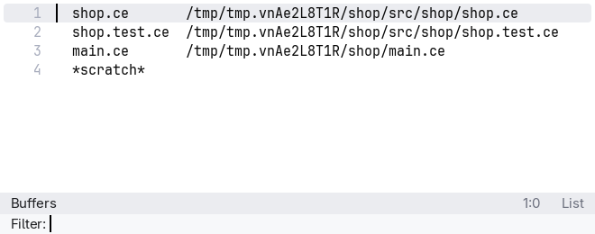
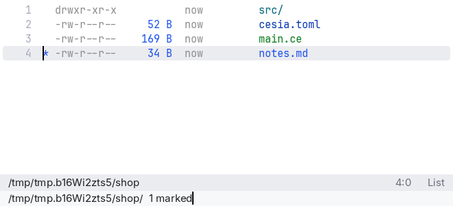

# Fichiers et buffers

Un buffer est un texte que Cemacs garde en mémoire, le plus souvent le texte d'un fichier. Vous modifiez le buffer ;
l'enregistrer l'écrit dans le fichier, et jusque-là le fichier sur le disque ne change pas. Chaque buffer a son propre
curseur, sa mark, son historique d'annulation et ses erreurs vérifiées. Ce chapitre dit comment les fichiers s'ouvrent et
s'enregistrent, quels fichiers s'ouvrent, comment les fins de ligne sont gardées, comment aller d'un buffer à un autre, et
présente le gestionnaire de dossiers. Les commandes sont dans [core/commands], le gestionnaire de dossiers dans
[src/folders].

## Ouvrir un fichier

| Touches | Commande | Ce qu'elle fait |
|---|---|---|
| `C-x C-f`, `C-c f f` | [commands.FindFile] | demande `Find file: ` (trouver le fichier) sur la prompt line, puis ouvre le fichier nommé |

La réponse commence par le dossier du fichier courant, pour qu'un fichier à côté de lui ne demande que son nom. C'est un
chemin tel que le système le lit : à partir du dossier où Cemacs a démarré pour un chemin relatif ; `~` n'y est qu'un nom,
pas votre dossier personnel. La prompt line accepte les lettres, Backspace, `C-y`, qui colle la première ligne du
presse-papiers, Enter et `C-g`, et vous ne modifiez la réponse qu'à son bout. Tab complète le nom (la completion, l'aide qui
finit un nom à partir des fichiers qui existent), comme dans Emacs : les noms du dossier qui commencent par la fin de la
réponse la complètent aussi loin qu'ils s'accordent, un dossier avec son `/` ; quand il en reste plusieurs, ils s'affichent
après la réponse, comme `{color/ | commands/ | complete/}`, dix au plus. Quand aucun ne commence ainsi, les noms qui
contiennent ses lettres dans l'ordre conviennent, comme le fait le filtre d'une liste : `nms` puis Tab donnent `names/`.
`M-p` et `M-n` reviennent aux fichiers déjà demandés, comme le dit
[La prompt line](windows.md#la-prompt-line).

Un fichier s'ouvre dans un nouveau buffer, qui devient le buffer courant, celui que vous modifiez. Un fichier déjà ouvert
n'est pas relu : Cemacs va à son buffer. Deux chemins nomment le même fichier quand ils sont pareils une fois enlevés les `.`,
les `..` et les barres obliques doublées, comme le fait [files.Normal] ; un lien symbolique n'est pas suivi : un fichier
ouvert par un lien et par sa cible a donc deux buffers.

```cesia
use core/files
files.Normal("./src/../src//main.ce") --> "src/main.ce"
```

Emacs appelle l'ouverture d'un fichier visiting (le visiter). `bin/cemacs a.ce b.ce` ouvre chaque fichier qu'on lui donne,
dans l'ordre, et reste sur le premier.

### Quels fichiers s'ouvrent

Un fichier qui n'existe pas s'ouvre comme un buffer vide, et il est créé au premier enregistrement. Sinon [files.ReadFile]
le lit, à moins qu'il ne soit l'un de ceux-ci, qui restent fermés avec un message sur la prompt line, le fichier intact :

| Le fichier | Le message |
|---|---|
| un dossier | `PATH is a folder.` (PATH est un dossier) |
| pas un fichier ordinaire : un device (un fichier spécial qui mène à un périphérique), une FIFO (un named pipe, un tuyau nommé), un socket | `PATH is not a regular file: it may be a device, a pipe or a socket.` (PATH n'est pas un fichier ordinaire : ce peut être un device, un pipe ou un socket) |
| plus grand que 1 GiB, 1 073 741 824 octets | `PATH is too large to open: SIZE bytes, and the limit is 1073741824.` (PATH est trop grand pour s'ouvrir : SIZE octets, et la limite est 1073741824) |
| pas de l'UTF-8 valide, ou contenant un octet nul | `PATH is not valid UTF-8 text, or holds a zero byte.` (PATH n'est pas un texte UTF-8 valide, ou contient un octet nul) |
| illisible, par exemple sans la permission du système | la raison que donne Cesia |

Un device ou une FIFO dit avoir la taille 0, et en lire un peut ne jamais finir ou remplir la mémoire : Cemacs demande donc
au système ce qu'est un fichier avant de le lire. La limite de taille empêche un fichier trop grand pour la mémoire d'arrêter
l'éditeur, avec le texte non enregistré de chaque buffer : un fichier prend un moment environ deux fois sa taille en mémoire
pendant qu'il s'ouvre, 193 MB au plus haut pour 99,9 MB, et [Vitesse](performance.md#ouvrir-un-fichier) donne ce que coûte un
grand fichier.

### Les encodages

Un encodage est la façon dont les caractères d'un texte deviennent des octets dans un fichier. Cemacs ne lit et n'écrit que
l'UTF-8, l'encodage du code Cesia et de la plupart des textes d'aujourd'hui, où un caractère prend de un à quatre octets. Un
fichier est de l'UTF-8 valide quand chacune de ses suites d'octets est une de celles que permet la RFC 3629 :
[files.IsText] refuse une overlong form (un caractère écrit en plus d'octets qu'il n'en faut) ; un surrogate (un code de
U+D800 à U+DFFF, qu'UTF-16 emploie par paires et qui n'est pas un caractère) ; et un code au-dessus de U+10FFFF, le dernier
d'Unicode. Un fichier en Latin-1 enfreint ces règles dès qu'il contient un caractère hors d'ASCII, et un fichier en UTF-16
contient des octets nuls : un tel fichier reste donc fermé, au lieu de montrer de faux caractères et d'être enregistré
abîmé.

[files.IsText] fait deux vérifications du texte entier, chacune un appel de la bibliothèque standard de Cesia, écrite en
OCaml, qui lit le texte là où il est, sans copie : [text.Count] compte ses octets nuls, qui doivent être zéro, et
[text.IsUtf8] dit s'il est de l'UTF-8 valide tel que le définit la RFC 3629. L'octet nul demande sa propre vérification,
car il est de l'UTF-8 valide, le caractère U+0000, qu'aucun fichier texte ne contient. Les deux lisent huit octets à la
fois : un mot de 64 bits contient huit octets, et quelques opérations sur le mot entier répondent pour les huit d'un coup,
une méthode appelée SWAR, SIMD within a register (SIMD, single instruction, multiple data, est la façon qu'a un processeur
de faire une seule opération sur plusieurs valeurs ensemble ; SWAR l'obtient avec les opérations ordinaires sur les
entiers). [text.IsUtf8] ne décode un caractère que là où un octet n'est pas ASCII. Sur 99,9 MB de code Cesia, mesurés
comme le dit [Vitesse](performance.md#ouvrir-un-fichier) : 34 ms pour compter les octets nuls, 24 ms pour vérifier l'UTF-8,
60 ms pour [files.IsText].

```cesia
use std/text
files.IsText("café") --> true
files.IsText(text.FromBytes([0x63, 0x61, 0x66, 0xE9])) --> false
files.IsText(text.FromBytes([0x61, 0, 0x62])) --> false
```

Le deuxième texte est `café` en Latin-1, où `é` est le seul octet `E9`. Un fichier qui commence par le byte order mark
d'UTF-8 (les octets `EF BB BF`, que certains programmes écrivent en premier) est de l'UTF-8 valide : il s'ouvre, la marque
reste le premier caractère du buffer, et un enregistrement la réécrit.

GNU Emacs, Neovim et Vim testent eux aussi l'UTF-8 quand ils lisent un fichier, mais là où le test échoue, ils prennent un
autre encodage : les quatre octets de `café` en Latin-1 s'ouvrent dans GNU Emacs 31.1 avec le coding system
`iso-latin-1-unix`, et dans Neovim 0.12.6 et Vim 9.2 avec le `fileencoding` `latin1`, le dernier de leur liste par défaut
`ucs-bom,utf-8,default,latin1` (chacun vérifié sur cette machine). Leur façon ouvre n'importe quel fichier, au risque de se
tromper : un fichier dans un autre encodage d'un octet par caractère, comme Windows-1252, montre de faux caractères en
Latin-1. Cemacs garde un seul encodage, et refuse ce qui n'en est pas plutôt que de deviner.

### Les fins de ligne

Une fin de ligne est le caractère, ou les deux, qui finissent une ligne : `\n`, un line feed (saut de ligne), sous Linux et
macOS, et `\r\n`, un carriage return (retour chariot) et un line feed, sous Windows. Cemacs garde celle de chaque ligne :

- Un `\r` juste avant un `\n` appartient à la fin de ligne : le curseur ne va jamais entre eux, et les colonnes ne le
  comptent pas.
- Enter insère la fin de ligne de la ligne où il est : `\r\n` dans une ligne qui finit ainsi, sinon `\n`. La dernière ligne,
  qui n'en a pas, prend celle de la ligne du dessus.
- Un `\r` partout ailleurs est un caractère ordinaire.
- L'enregistrement écrit le texte tel qu'il est : un fichier en `\r\n` le reste, un mélange reste un mélange, et aucune fin
  de ligne n'est ajoutée ni enlevée à la fin du fichier.

## Enregistrer

| Touches | Commande | Ce qu'elle fait |
|---|---|---|
| `C-x C-s`, `C-c f s` | [commands.Save] | enregistre le buffer courant dans son fichier ; un buffer sans fichier demande d'abord `Save as: ` (enregistrer sous) |

Après un enregistrement, la prompt line dit `Saved PATH` (PATH enregistré), l'étoile de la mode line s'en va, et chaque
buffer Cesia est vérifié à nouveau, puisqu'un autre fichier peut employer celui qu'on vient d'enregistrer : voir
[Les erreurs dans les lignes](check.md).

### Ne jamais perdre le texte

L'enregistrement est construit pour qu'aucun échec ne perde de texte, ni le texte sur le disque, ni celui du buffer :

1. Le nouveau texte va dans un nouveau fichier à côté de l'ancien, dans son dossier, nommé `.#cemacs-` suivi de 32
   chiffres tirés à nouveau de `std/random`, [files.FreshName] : 41 octets, si bien qu'un fichier de n'importe quel nom
   peut être enregistré. Le nouveau fichier est le seul que Cemacs enlève jamais. Quand PATH est un lien symbolique, un
   fichier qui ne fait que pointer vers un autre, PATH est ici le fichier vers lequel il pointe, ses liens suivis l'un
   après l'autre, comme le fait le `file-truename` d'Emacs : le lien reste un lien, et le fichier où il mène reçoit le
   texte.
2. Le nouveau fichier est écrit avec `sys.Write(..., sync = true, mode = MODE, group = GROUP, new = true)`, le mode et le
   groupe de l'ancien fichier. Avec `new = true`, il n'est créé que neuf, [files.MakeFresh] : un lien ou un fichier que
   quelqu'un a mis à son nom d'abord, comme dans `/tmp`, n'est jamais écrit à travers et reste tel qu'il était, et un
   autre nom est tiré, 8 au plus, si bien que le nom n'a pas besoin d'être impossible à deviner. Cesia crée le fichier à
   vous seul, `rw-------`, lui donne le groupe, puis le mode, avant que le texte y soit, pour que le texte ne soit jamais
   dans un fichier aux autres droits ; et il ne répond qu'une fois que le système a mis le fichier sur le disque, puis son
   dossier, avec `fsync` : l'appel qui demande au système d'écrire ce qu'il garde dans ses caches, pour qu'une coupure de
   courant ne puisse pas le reprendre.
3. Une fois qu'il est sur le disque en entier, un renommage le met à la place de l'ancien fichier, sans que rien ne lui
   soit fait par son nom entre les deux. Sous Linux, un renommage à l'intérieur d'un même système de fichiers, comme ici,
   est atomique : à chaque instant, le nom mène à tout l'ancien fichier ou à tout le nouveau, jamais à une partie de l'un
   ou de l'autre.
4. Si l'écriture ou le renommage échoue, le nouveau fichier est enlevé, l'ancien reste entier, le buffer garde son texte et
   son étoile, et la prompt line dit la raison, en nommant votre fichier, pas le nouveau.

Cela protège le fichier d'un échec de Cemacs, d'un disque plein, d'une permission, et d'une coupure de courant : une fois
que la prompt line dit `Saved`, tout le nouveau texte est sur le disque, sous le nom de votre fichier, ou, si le courant a
été coupé à l'instant du renommage avant que le système ait réécrit le dossier, sous le nom du nouveau fichier
`.#cemacs-...`, à côté de l'ancien fichier, qui est alors entier. Vim et Neovim font de même par défaut (leur option
`'fsync'`) ; GNU Emacs 31 non, car son `write-region-inhibit-fsync` est activé. Le coût est le temps que prend le disque :
[Vitesse](performance.md#coller-annuler-et-enregistrer) le donne.

Le fichier enregistré est un nouveau fichier qui a le mode et le groupe de l'ancien : un fichier privé reste `rw-------`,
un script garde son droit d'être lancé, un fichier en lecture seule reste en lecture seule, et un fichier d'un groupe, comme
`rw-rw----` pour une équipe, reste au groupe. Ses bits setuid et setgid (lancer avec les droits du propriétaire ou du
groupe) ne passent pas, car le nouveau fichier est à vous, pas au propriétaire de l'ancien. Un groupe que le système ne vous
laisse pas donner, comme un groupe dont vous n'êtes pas, est laissé : le texte va alors dans un autre nouveau fichier, qui a
le groupe qu'un nouveau fichier reçoit dans ce dossier, comme le donnait chaque enregistrement avant que Cemacs garde le
groupe, et l'enregistrement marche. Un fichier qui n'était pas là reçoit ce que le système donne à un nouveau fichier,
`rw-rw-rw-` moins l'`umask` (le masque par lequel le système retire des droits à chaque nouveau fichier), tel que Linux le
dit dans `/proc/self/status` ; `rw-------` là où il ne le dit pas. Un hard link (un second nom du même fichier) ne partage
plus le texte. Le dossier doit vous permettre d'y écrire, pour le nouveau fichier.

### Un fichier changé par un autre programme

Quand Cemacs lit un fichier, il note sa taille et l'heure de son dernier changement. Un enregistrement regarde d'abord à
nouveau : si un autre programme, `git` par exemple, a changé le fichier depuis, ou a créé un fichier là où Cemacs n'en avait
vu aucun, rien n'est écrit et la prompt line demande `File changed on disk. Overwrite? (y or n)` (le fichier a changé sur le
disque ; l'écraser ? y pour oui, n pour non). `y` écrit votre texte par-dessus, de la même façon sûre ; `n` dit `Not saved.`
(pas enregistré) et laisse les deux textes tels qu'ils sont. [files.SaveFile] fait la vérification :

```cesia allow=read,write
use std/result
use std/sys
sys.Write("notes.txt", "one")
read = result.Unwrap(files.ReadFile("notes.txt"))
result.IsOk(files.SaveFile("notes.txt", "second", read.Disk)) --> true
files.SaveFile("notes.txt", "third", read.Disk) --> result.Err({Kind: "changed", Message: "notes.txt changed on disk since it was read."})
```

Le second enregistrement donne la taille et l'heure de la première lecture, et le fichier a changé depuis : l'enregistrement
entre les deux en a fait un nouveau fichier. Cemacs ne regarde qu'au moment d'enregistrer : il ne recharge pas un fichier qui
change pendant qu'il est ouvert, comme le ferait l'`auto-revert-mode` d'Emacs, et il n'a pas de commande pour le relire.

### Enregistré comme cesia fmt l'écrit

Un fichier de Cesia, un fichier `.ce`, est enregistré comme
[`cesia fmt`](https://www-celestial.github.io/cesia-lang/commands.html) l'écrit : chaque ligne à l'indentation de ses blocs,
pas d'espace en fin de ligne, pas deux lignes vides de suite. Le texte va dans un fichier à lui dans `.cesia/fmt/` du
dossier de Cemacs, à vous seul, `rwx------`, comme l'est la copie, `rw-------`, car le fichier peut être un fichier privé,
`cesia fmt` le met en forme, et c'est le texte mis en forme qui est enregistré ; le buffer le prend
aussi, en une étape d'annulation, si bien que `C-/` rend ce que vous avez tapé, le curseur sur sa ligne. Le fichier de
`.cesia/fmt/` est effacé aussitôt. Un texte qui ne se lit pas, comme un texte où un crochet reste ouvert, est enregistré tel
qu'il est tapé, et la prompt line dit `Saved PATH as typed:` et pourquoi `cesia fmt` l'a laissé. L'enregistrement d'un
fichier de 2 000 lignes prend 60 ms par `cesia fmt`, 8 ms sans : [Vitesse](performance.md#coller-annuler-et-enregistrer).

### Enregistrer sous

Un buffer sans fichier demande `Save as: ` et enregistre au chemin donné, qui ne devient son fichier qu'une fois
l'enregistrement réussi. Une réponse vide dit `No file name.` (pas de nom de fichier) ; un fichier ouvert dans un autre
buffer est refusé avec `PATH is open in another buffer.` (PATH est ouvert dans un autre buffer), car un même fichier aurait
alors deux buffers avec deux textes ; et pour un fichier qui existe déjà à cet endroit, Cemacs demande
`File changed on disk. Overwrite? (y or n)`, comme ci-dessus. Une liste, comme la liste des buffers, n'a pas de fichier :
l'enregistrer dit `A list has no file.` (une liste n'a pas de fichier)

### Ce que Cemacs n'écrit pas

Cemacs ne fait pas de fichier de backup (de copie de sauvegarde), comme le `notes.ce~` d'Emacs, pas de fichier d'autosave
(d'enregistrement automatique), et pas de lock file (le fichier qui signale aux autres éditeurs qu'un fichier est en cours de
modification). Le texte non enregistré ne vit qu'en mémoire : quitter demande d'abord, mais un crash de l'éditeur le perd.
Enregistrez souvent.

## Les buffers

| Touches | Commande | Ce qu'elle fait |
|---|---|---|
| `C-x b`, `C-c b n` | [commands.NextBuffer] | va au buffer suivant, du dernier au premier |
| `C-x C-b`, `C-c b b` | [buffers.Open] | ouvre la liste des buffers |
| `C-x k`, `C-c b k` | [commands.CloseBuffer] | ferme le buffer courant, en demandant d'abord si son texte n'est pas enregistré |
| `C-x C-c`, `C-c q q` | [commands.Quit] | termine Cemacs, en demandant d'abord si un texte n'est pas enregistré |



Le nom d'un buffer est la dernière partie de son chemin, comme la mode line et le titre de la fenêtre le montrent,
`untitled` (sans titre) pour un buffer sans fichier, ou le nom d'une liste. Deux fichiers du même nom dans deux dossiers
montrent le même nom : la liste des buffers donne leurs chemins.

La liste des buffers a une rangée pour chaque buffer, avec une étoile pour un texte non enregistré, son nom, et son chemin.
C'est une liste : un buffer de rangées que la frappe filtre, en lecture seule, où Enter sur une rangée va à ce buffer et
ferme la liste. Voir [Recherche](search.md#les-listes) pour la façon dont un filtre trouve une rangée.

Fermer un buffer dont le texte n'est pas enregistré demande `Text not saved. Close anyway? (y or n)` (texte non enregistré ;
fermer quand même ?). Fermer le dernier buffer laisse un buffer vide, pour qu'il y en ait toujours un. Un pane qui montrait
le buffer fermé montre celui qui prend sa place.

Quitter demande `Text not saved. Quit anyway? (y or n)` (texte non enregistré ; quitter quand même ?) quand un buffer n'est
pas enregistré, et il en va de même pour la fermeture de la fenêtre et pour le signal TERM ou INT, comme celui qu'envoie
`Ctrl-C` dans le terminal qui a lancé Cemacs : une question qui était ouverte cède sa place à celle-ci.

## Le gestionnaire de dossiers

| Touches | Commande | Ce qu'elle fait |
|---|---|---|
| `C-x d`, `C-c f d` | [folders.Open] | ouvre le dossier du fichier courant, ou le dossier où Cemacs a démarré |

Le gestionnaire de dossiers est une liste des fichiers et des dossiers d'un dossier, comme Dired dans Emacs, et il en prend
les touches : chaque lettre que vous tapez est une commande, `n` la rangée suivante, `m` une marque, `C` une copie, `D` un
effacement, et `?` dit les principales sur la prompt line. Une commande agit sur les rangées marquées d'un `*`, ou, s'il n'y
en a aucune, sur la rangée sous le curseur. La liste est nommée par le chemin absolu du dossier. La prompt line montre ce
chemin, terminé par `/`, puis ce que la liste contient de plus : le nombre de rangées marquées et signalées, le tri quand il
n'est pas par nom, `hidden shown` (les noms cachés montrés), ou, sans rien de cela, `backspace: folder above, q: close, ?: keys`
(`backspace` remonte au dossier du dessus, `q` ferme la liste, `?` donne les touches). L'état d'une liste, son dossier, ses marques et sa façon de les montrer, est un record, la vue, que
[folders.NewView] commence et que [folders.ViewOf] lit.



### Les rangées

Voici les rangées d'un dossier, telles que [folders.Rows] les fait à partir de ses entrées, deux heures après le dernier
changement de chacune, avec `LICENSE` marqué :

```cesia
use src/folders
use std/io
entries = [{Name: "cesia.toml", IsDir: false, Size: 262, Modified: 0, Mode: 420}, {Name: "src", IsDir: true, Size: 0, Modified: 0, Mode: 493},
  {Name: ".git", IsDir: true, Size: 0, Modified: 0, Mode: 493}, {Name: "LICENSE", IsDir: false, Size: 1069, Modified: 0, Mode: 420},
  {Name: "run", IsDir: false, IsLink: true, Size: 120, Modified: 0, Mode: 493, Target: "bin/cemacs"}]
for row in folders.Rows(entries, false, 7200, marks = {"LICENSE": "*"})
  io.Print(row.Words)
end
```

Chaque rangée commence par sa marque, dans une colonne à elle : `*` marquée, `D` signalée pour l'effacement, une espace pour
aucune. Une marque, ici, est ce signe au début d'une rangée, qu'il ne faut pas confondre avec la mark d'Emacs, qui commence
une sélection. Viennent ensuite ses détails : le mode, sa taille et son âge ; `(` les cache, et les montre à nouveau. Le
mode (les droits d'un fichier : qui peut le lire, l'écrire, le lancer) s'écrit comme `ls -l` l'écrit, comme le fait
[folders.ModeText] : le genre, `d` pour un dossier, `l` pour un lien symbolique (un fichier qui renvoie vers un autre
chemin), `-` pour un fichier, puis trois lettres pour chacun du propriétaire, du groupe et des autres, `r` pour lire, `w`
pour écrire et `x` pour lancer, ou entrer dans un dossier ; `s` et `t` tiennent la place des bits set-id (lancer avec les
droits du propriétaire ou du groupe) et sticky (dans un dossier partagé, seul le propriétaire d'un fichier peut l'effacer).
Un lien montre `lrwxrwxrwx`, comme Linux le donne à tout lien, puis la taille et l'âge de ce vers quoi il pointe, et son nom
finit par `->` et sa cible. Un mode est un nombre de 0 à 4095, que Cesia écrit en décimal : 420 est `644` en octal,
`rw-r--r--`.

Un nom, et la cible d'un lien, s'écrit comme `ls -b` l'écrit, par [folders.NameText] : une barre oblique inverse doublée, et
chaque caractère de contrôle (un caractère qui ne s'affiche pas mais commande le terminal), un octet de 1 à 31 ou 127,
échappé (écrit en caractères visibles) comme C l'écrit dans un texte, `\n`, `\t`, `\r`, ou par son nombre en octal, `\033`
pour ESC. Quiconque peut écrire dans un dossier peut y créer un nom qui contient une fin de ligne, et une rangée coupée là
montrerait le fichier suivant sur la ligne du curseur pendant qu'une touche agirait sur celui du dessus : ici une rangée est
toujours un seul fichier, celui qu'elle montre. La prompt line écrit de la même façon les caractères de contrôle de ce
qu'elle montre, par [lists.Escaped], et toute liste fait de même pour une rangée qui contient une fin de ligne.

```cesia
folders.PermissionText(420) --> "rw-r--r--"
folders.OctalText(493) --> "755"
folders.SizeText(3250) --> "3.3 kB"
folders.AgeText(7200, 0) --> "2 h"
```

Un fichier montre sa taille, comptée par 1000 : `B` pour les octets jusqu'à 999, puis `kB`, `MB`, `GB` et `TB`, avec une
décimale en dessous de 10, comme le fait [folders.SizeText]. Son âge dit quand il a changé pour la dernière fois : `now`
(maintenant) en dessous d'une minute, puis les minutes, les heures, et les jours jusqu'à 30, puis la date, comme le fait
[folders.AgeText]. La date est en UTC, l'heure de Greenwich, et une rangée ne montre pas l'heure du jour ; `y` la dit, sur
l'horloge de cette machine. Les âges sont ceux du moment où le dossier a été lu : `g` le relit.

Les dossiers viennent d'abord, chacun avec un `/` après son nom, puis les fichiers, chaque groupe dans l'ordre des noms. `s`
les trie plutôt par date, le plus récent d'abord, puis par taille, le plus grand d'abord, puis à nouveau par nom, comme le
fait [folders.Sorted] ; les dossiers restent devant dans chaque tri. Les noms prennent les couleurs du code selon ce qu'ils
sont : un dossier comme un nom, un dossier ou un fichier caché pâle comme un commentaire, le code comme un texte (`.ce`,
`.ml`, `.c`, `.py`, `.sh`, `.el` et d'autres langages), les réglages et les données comme un mot-clé (`.toml`, `.json`,
`.yaml`, `.csv`, `.lock` et d'autres), les images, les polices et les archives comme un champ (`.png`, `.svg`, `.ttf`,
`.pdf`, `.zip`, `.tar` et d'autres), tout le reste sans couleur. Le nom d'une rangée marquée prend la couleur de sa marque.
Un nom qui commence par un point est caché, comme le font la plupart des gestionnaires de fichiers sous Linux : `.` ou
`C-c .` montre les noms cachés, ou les cache à nouveau.

### Se déplacer et ouvrir

| Touches | Commande | Ce qu'elle fait |
|---|---|---|
| `n`, Espace, `C-n`, `down` | [folders.Next] | la rangée suivante |
| `p`, `C-p`, `up` | [folders.Previous] | la rangée d'avant |
| `>`, `<` | [folders.NextFolder], [folders.PreviousFolder] | la rangée suivante d'un dossier, ou celle d'avant |
| `^` | [folders.Up] | le dossier du dessus, le curseur sur celui qu'on vient de quitter |
| `backspace` | [folders.Back] | le dossier du dessus aussi, comme `^` ; pendant que `/` filtre, il défait d'abord les lettres tapées |
| `enter`, `e`, `f`, `v` | [folders.Visit] | un dossier s'ouvre dans la liste ; un fichier s'ouvre dans un buffer, et la liste se ferme |
| `o` | [folders.OpenOther] | ouvre la rangée dans l'autre pane, qu'un partage crée quand il n'y a qu'un pane, et y va |
| `C-o` | [folders.ShowOther] | montre la rangée dans l'autre pane, et reste dans la liste |
| `j` | [folders.Jump] | demande `Jump to file: ` (aller au fichier), le dossier montré d'abord, et met le curseur sur le nom ; Tab le complète |
| `g` | [folders.Refresh] | relit le dossier, en gardant les marques des noms toujours là |
| `q` | [folders.Quit] | ferme la liste, et revient au buffer d'où elle a été ouverte |
| `C-g` | | enlève un filtre gardé, ou, s'il n'y en a pas, ferme la liste, comme dans toute liste |

L'autre pane est le suivant, celui où va `C-x o`. Un pane se partage côte à côte, ou, quand il est trop étroit, l'un au-dessus
de l'autre. `o` et `C-o` sur un dossier y montrent sa liste : deux dossiers côte à côte, ce dont une copie ou un déplacement
se sert d'abord, comme le dit [Agir sur les fichiers](#agir-sur-les-fichiers). `j` prend aussi un chemin : un nom dans un
autre dossier montre ce dossier, le curseur sur lui, et un nom qu'un filtre ou le point cachait est montré à nouveau. `^` à
la racine dit `This is the root.` (c'est la racine).

### Filtrer et taper un chemin

| Vous tapez | Ce que cela fait |
|---|---|
| `/` | commence le filtre : ce que vous tapez ensuite s'ajoute au chemin de la prompt line |
| des lettres, après `/` | filtrent les noms, comme dans toute liste |
| une partie du nom d'un dossier, puis `/` | entre dans le dossier sous le curseur si c'en est un, sinon dans le premier dossier montré, ou dit `No folder matches.` (aucun dossier ne correspond) |
| `/` sans rien de tapé | va à la racine, `/` |
| `~`, puis `/` | va à votre dossier personnel, d'après `HOME`, ou dit `HOME is not set.` (HOME n'a pas de valeur) |
| `backspace` | défait la dernière lettre, ou, s'il n'y en a pas, va au dossier du dessus, le curseur sur celui qu'on vient de quitter |
| `enter` | garde le filtre, et rend les lettres aux commandes |
| `C-g` | enlève le filtre, et rend les lettres aux commandes |
| `C-y` | va au chemin du presse-papiers : un dossier s'ouvre, un fichier montre son dossier avec le curseur sur lui |

[folders.StartFilter] est le `/` qui le commence. Le filtre est propre à Cemacs : Dired n'en a pas, et ses lettres sont des
commandes. Un filtre gardé par Enter se montre sur la prompt line après un `/`, et les commandes agissent alors sur les
rangées qu'il montre, et sur les marquées parmi elles : une rangée que le filtre cache n'est jamais copiée ni effacée.
`backspace` à la racine dit `This is the root.` Un chemin collé peut commencer par `/`, par `~`, ou être relatif au dossier
montré ; un chemin qui ne mène nulle part dit `No file or folder at PATH.` (pas de fichier ni de dossier à PATH). `C-y`
marche aussi sans `/`.

### Les marques

| Touches | Commande | Ce qu'elle fait |
|---|---|---|
| `m`, `* m` | [folders.Mark] | marque la rangée sous le curseur d'un `*`, et passe à la suivante |
| `u`, `* u` | [folders.Unmark] | enlève sa marque, et passe à la suivante |
| aucune touche | [folders.UnmarkBack] | va à la rangée du dessus, et enlève sa marque, comme `DEL` dans Dired ; ici `backspace` remonte au dossier du dessus, donnez-lui donc une touche dans votre config pour la façon de Dired |
| `d` | [folders.Flag] | signale la rangée pour l'effacement d'un `D`, et passe à la suivante |
| `U`, `* !` | [folders.UnmarkAll] | enlève toutes les marques |
| `t`, `* t` | [folders.ToggleMarks] | marque les rangées sans marque, et démarque celles marquées d'un `*` ; un `D` reste |
| `* /` | [folders.MarkFolders] | marque chaque dossier, mais pas un lien vers un dossier |
| `* @` | [folders.MarkLinks] | marque chaque lien symbolique |
| `* *` | [folders.MarkPrograms] | marque chaque fichier que quelqu'un peut lancer, d'après le `x` de son mode |
| `* .` | [folders.MarkExtension] | demande `Mark extension: ` (marquer l'extension), celle de la rangée sous le curseur d'abord, et marque chaque fichier qui finit ainsi |
| `* s` | [folders.MarkAll] | marque chaque rangée |
| `* c` | [folders.ChangeMarks] | demande une marque et celle qui prend sa place : `D` puis `*` marque les rangées signalées |
| `% m`, `* %` | [folders.MarkMatching] | demande `Mark (regexp): ` (marquer, une expression régulière) et marque chaque rangée dont le pattern trouve le nom |
| `% d` | [folders.FlagMatching] | demande `Flag for deletion (regexp): ` (signaler pour l'effacement) et signale chaque rangée dont le pattern trouve le nom |
| `% g` | [folders.MarkHolding] | demande `Mark files containing (regexp): ` (marquer les fichiers qui contiennent) et marque chaque fichier dont le pattern trouve le texte |
| `~` | [folders.FlagBackups] | signale chaque copie de sauvegarde, un nom qui finit par `~`, comme Emacs les fait |
| `#` | [folders.FlagAutoSaves] | signale chaque fichier d'auto-save (l'enregistrement qu'un éditeur fait seul), un nom entre deux `#`, comme Emacs les fait |
| `M-}`, `M-{` | [folders.NextMarked], [folders.PreviousMarked] | la rangée suivante qui a une marque, ou celle d'avant, en repartant du début après la fin |

Les marques restent à travers un tri, un filtre et `g`, tant que leurs noms sont là ; elles s'en vont avec le dossier qu'on
quitte. `*` et `%` attendent une deuxième touche, comme la prompt line le dit par `* -` ; `C-g` les reprend, et une deuxième
touche sans commande le dit. Un pattern (un motif, l'expression régulière qui décrit les textes cherchés) est un pattern de
[std/regex](https://www-celestial.github.io/cesia-lang/texts.html#regular-expressions), dont le temps reste linéaire quel que
soit le pattern : aucun ne peut bloquer l'éditeur. Un pattern faux est dit sur la prompt line, comme
`Bad pattern: a class isn't closed.` (une classe n'est pas fermée), et rien n'est marqué : [folders.PatternError] le vérifie
d'abord, car std/regex arrête le programme qui lui en donne un faux. `% g` lit les fichiers de 1 MB au plus, et laisse de côté
ceux qui contiennent un octet nul, qui ne sont pas du texte.

### Agir sur les fichiers

| Touches | Commande | Ce qu'elle fait |
|---|---|---|
| `C` | [folders.Copy] | demande `Copy NAME to: ` (copier NAME vers) et copie, un dossier avec tout ce qu'il contient |
| `R`, `C-c r` | [folders.Rename] | demande `Rename NAME to: ` (renommer NAME en) et renomme, ou déplace dans un dossier, d'un disque à l'autre aussi |
| `S` | [folders.Symlink] | demande `Symlink NAME from: ` (lien symbolique vers NAME depuis) et y crée un lien symbolique vers le fichier, avec son chemin depuis la racine |
| `Y` | [folders.RelativeSymlink] | la même chose avec un chemin relatif, comme `../lib/a.so` |
| `H` | [folders.HardLink] | demande `Hardlink NAME to: ` et crée un hard link (un autre nom du même fichier, sur le même disque) |
| `M` | [folders.ChangeMode] | demande `Change mode of NAME to: ` (changer le mode de NAME en), le mode d'un fichier d'abord, et donne le mode |
| `T` | [folders.Touch] | demande `Change time of NAME to (none for now): ` (changer l'heure de NAME, rien pour maintenant) et donne l'heure de son dernier changement, comme le fait `touch` |
| `+` | [folders.MakeFolder] | demande `Create folder: ` (créer le dossier), ce dossier d'abord, et le crée, avec les dossiers au-dessus de lui |
| `C-c n` | | demande `New file, or folder/: ` (nouveau fichier, ou dossier/) : un nom qui finit par `/` crée un dossier, tout autre un fichier vide |
| `w` | [folders.CopyNames] | copie les noms dans le presse-papiers, une espace entre eux |
| `W` | [folders.CopyPaths] | copie les chemins depuis la racine dans le presse-papiers, une espace entre eux |
| `y` | [folders.WhatIs] | dit ce qu'est la rangée : son genre, sa taille, son mode en lettres et en octal, l'heure de son dernier changement, et pour un lien sa cible |

Une commande agit sur les rangées marquées d'un `*` que la liste montre, ou, s'il n'y en a aucune, sur la rangée sous le
curseur ; sa question les nomme, par le nom d'une seule, ou `* [3 files]` pour plusieurs, comme le fait Dired. La réponse de
`C`, `R`, `S`, `Y` et `H` est un chemin, depuis le dossier montré quand il ne commence pas par `/`, et Tab le complète comme
dans `Find file`. Elle commence par le dossier de l'autre pane, quand ce pane montre la liste d'un dossier, comme le fait
`dired-dwim-target` dans Dired (deviner la cible : le dossier d'à côté), ou sinon par ce dossier-ci, et, pour un seul fichier,
par son nom après lui : Enter seul copie ou déplace le fichier dans l'autre pane sous son propre nom. Un seul fichier va dans
la réponse quand elle est un dossier ou finit par `/`, sinon il la prend comme nouveau nom ; plusieurs fichiers vont dedans,
un dossier. Une réponse qui finit par `/` et ne nomme encore aucun dossier le crée. [folders.Destinations] dit où chacun va.

```cesia
use std/result
result.Unwrap(folders.Destinations([{Name: "a.ce", IsDir: false}], "/p", "/q/"))[1].To --> "/q/a.ce"
```

Un fichier déjà là n'est remplacé qu'après un oui : `b.ce exists. Replace it? (y or n)` (b.ce existe, le remplacer ?), ou,
pour plusieurs, `3 exist (a.ce, b.ce, c.ce). Replace them? (y or n)` ; n laisse ceux-là, et les autres continuent. Un dossier
copié sur un dossier qui est là lui donne ce qu'il contient, les fichiers de même nom remplacés. Un dossier n'est jamais
copié ni déplacé dans lui-même : `Can't copy src into itself.` (impossible de copier src dans lui-même), et rien n'est créé.
Après chaque commande, le dossier est relu, et la liste de l'autre pane aussi ; la prompt line dit ce qui a été fait, comme
`Copied 3 files.` (3 fichiers copiés).

Une copie d'un dossier, [folders.CopyTree], est le [sys.CopyTree] de Cesia, qui parcourt les deux arbres par les
dossiers qu'il tient ouverts, jamais par des chemins refaits : un dossier que quelqu'un d'autre remplace par un lien
pendant qu'elle tourne, dans l'arbre copié ou dans la copie, ne mène aucune lecture ni aucune écriture hors d'eux, et la
copie continue, entière, là où elle a commencé. Chaque fichier est copié comme le fait `cp -p`, avec son mode et ses
heures ; un dossier reçoit son mode et ses heures une fois tout ce qu'il contient en place, le plus profond d'abord, et
celui qu'elle crée est à vous seul, `rwx------`, jusque-là ; un lien symbolique est refait avec la même cible, jamais
suivi, un lien vers rien aussi. Les dossiers au-dessus de la copie sont créés là où ils manquent, comme `mkdir -p` les
crée, et une copie dans elle-même est refusée, à travers un lien aussi. La première entrée qui échoue arrête la copie,
comme s'arrête le `copy-directory` d'Emacs : la prompt line la nomme, dans les deux arbres, comme `Copied 0 of 1; src:
Can't copy /p/src/deep to /q/src/deep: not a directory. The copy stopped there; what it copied before stays.` (la copie
s'est arrêtée là ; ce qu'elle a copié avant reste), et les autres fichiers marqués continuent ; les dossiers qu'elle a
créés sans les finir restent à vous seul. C'est le cas là où la copie a un dossier et la cible un lien ou un fichier,
rien n'allant dessous, et pour un fichier spécial, comme une FIFO (un tube nommé) ou un périphérique, qui n'est jamais
lu, car en lire un peut attendre sans fin : Cesia dit `operation not supported` (opération non prise en charge). Un
fichier ou un lien copié seul est écrit à un nom à lui à côté de sa place, puis renommé par-dessus ce qui était là,
comme le fait [folders.Placed] : ce qui était là reste entier jusqu'à ce que le nouveau le soit, et un fichier copié sur
lui-même par un autre chemin reste tel qu'il était. Ce nom n'est créé que neuf, comme celui d'un enregistrement,
[files.MakeFresh], avec `sys.Copy(..., new = true)` : un lien ou un fichier mis à ce nom d'abord n'est jamais écrit à
travers, et un autre nom est tiré. Un fichier spécial seul est nommé et laissé. Un déplacement, [folders.MoveTree], est
un renommage ; d'un disque à l'autre, où un renommage ne peut pas aller, il copie, puis efface ce qu'il a copié,
seulement une fois la copie entière, comme le fait un effacement pour de bon. Les buffers des fichiers déplacés, et de
ceux qui sont dans les dossiers déplacés, prennent leur nouveau chemin, pour qu'un enregistrement aille là où le fichier
est maintenant.

Le mode de `M` est en octal, comme `644` ou `0755`, ou écrit comme `chmod` l'écrit, [folders.ParseMode] : des clauses
séparées par des virgules, chacune avec qui, parmi `u` le propriétaire, `g` le groupe, `o` les autres et `a` tous, rien
valant `a`, puis `+` pour ajouter, `-` pour enlever ou `=` pour fixer, puis quoi, parmi `r`, `w`, `x`, `X`, qui vaut `x` pour
un dossier ou pour un fichier que quelqu'un peut déjà lancer, `s` et `t`. Chaque fichier reçoit le mode calculé à partir du
sien :

```cesia
folders.ParseMode("u+x,go-w", 438, false) --> result.Ok(484)
folders.ParseMode("a+X", 420, true) --> result.Ok(493)
result.IsErr(folders.ParseMode("u+q", 420, false)) --> true
```

La réponse de `T` est rien, pour maintenant, un jour, `2026-11-21`, à minuit, ou un jour et une heure, `2026-11-21 14:30`,
ou avec les secondes, sur l'horloge de cette machine, comme le lit [folders.TimeOf]. `C-c n` est propre à Cemacs ; un nom
qui existe déjà est refusé avec `NAME already exists.` (NAME existe déjà), et un nom vide dit `No name.` (pas de nom).

Une erreur sur un fichier le nomme, et les autres continuent : `Copied 2 of 3; b.ce: permission denied` (2 copiés sur 3 ;
b.ce : permission refusée), avec le nombre des autres échecs.

### Effacer

| Touches | Commande | Ce qu'elle fait |
|---|---|---|
| `D`, `C-c k` | [folders.Delete] | efface les rangées marquées, ou la rangée sous le curseur, après une question |
| `x` | [folders.DeleteFlagged] | efface les rangées signalées d'un `D`, après une question |

Chaque effacement demande d'abord. Le réglage [emacs.DeleteToTrash], vrai tant que vous ne le changez pas, comme
`delete-by-moving-to-trash` dans Doom Emacs, dit où vont les fichiers :

- Vrai : à la corbeille, un dossier entier, après `Move NAME to the trash? (y or n)` (mettre NAME à la corbeille ?) ; la
  prompt line dit ensuite `Moved to the trash NAME.` (NAME mis à la corbeille). Un fichier peut en revenir, comme le dit
  [La corbeille](#la-corbeille).
- Faux : pour de bon, après `Delete NAME for good? (yes or no)` (effacer NAME pour de bon ?), qui veut le mot `yes`, tapé, et
  Enter ; chaque dossier qui contient quelque chose demande alors une fois de plus, par son nom :
  `Delete folder NAME and everything in it? (yes or no)` (effacer le dossier NAME et tout ce qu'il contient ?). Un non laisse
  ce dossier, et les autres s'en vont. La prompt line dit ensuite `Deleted NAME.` (NAME effacé). Un lien symbolique est
  effacé, jamais ce vers quoi il pointe, dans un dossier aussi : l'effacement est le [sys.RemoveTree] de Cesia, qui n'en
  suit jamais aucun. Il va de dossier en dossier par ceux qu'il tient ouverts, jamais en refaisant leurs chemins, si bien que
  quelqu'un qui peut écrire dans le dossier du dessus, comme dans `/tmp` ou un dossier partagé, et qui remplace le dossier
  par un lien pendant qu'il tourne ne peut pas l'en faire sortir : rien hors du dossier n'est touché. Le premier fichier qui
  ne peut pas être effacé l'arrête, et il est nommé : `Deleted 0 of 1; big: Can't remove /tmp/big/f12: permission denied.`
  (0 effacé sur 1 ; big : impossible d'enlever /tmp/big/f12 : permission refusée)

[Changer Cemacs](customising.md#les-réglages) dit comment le régler dans votre `Changed` : `c.DeleteToTrash = () -> false`.
Après un effacement, le curseur va à la rangée qui a pris la place de la première partie.

### La corbeille

Cemacs suit la Trash specification de freedesktop.org, version 1.0, pour la corbeille de votre dossier personnel, le dossier
d'où le gestionnaire de fichiers de votre bureau peut restaurer un fichier :

- La corbeille est `$XDG_DATA_HOME/Trash`, ou `~/.local/share/Trash` quand `XDG_DATA_HOME` n'a pas de valeur. Sans `HOME`
  non plus, elle dit `There is no trash: HOME is not set.` (il n'y a pas de corbeille : HOME n'a pas de valeur). La
  corbeille, son `files/` et son `info/` sont à vous seul, `rwx------`, comme GIO (la bibliothèque de fichiers de GNOME) les
  crée, et chaque fichier d'informations aussi, `rw-------` : ce que vous avez effacé, et d'où, ne regarde personne d'autre.
- Le fichier ou le dossier va dans `files/`, sous son propre nom, ou `NAME.2`, `NAME.3` et ainsi de suite quand celui-ci est
  pris.
- Ses informations vont d'abord dans `info/NAME.trashinfo`, comme le demande la spécification : son chemin depuis la racine,
  chaque partie percent-encoded (chaque caractère spécial écrit `%` et deux chiffres, comme les URL écrivent une espace
  `%20`), et la date de sa mise à la corbeille. Si le déplacement échoue ensuite, les informations sont enlevées.

```cesia
use std/date
folders.TrashInfo("/home/me/my notes.ce", date.FromUnix(0)) --> "[Trash Info]\nPath=/home/me/my%20notes.ce\nDeletionDate=1970-01-01T00:00:00\n"
```

Les informations sont datées sur l'horloge de cette machine, dans son fuseau horaire, comme le demande la spécification :
[folders.TrashInfo] écrit la date qu'on lui donne sous la forme `YYYY-MM-DDThh:mm:ss`, et la corbeille lui donne le
[date.Local] du moment.

Cemacs s'écarte de la spécification sur deux points. Il trouve un nom libre en regardant les noms pris, là où la
spécification demande une création exclusive (une création qui échoue quand quelque chose existe déjà à ce nom, `O_EXCL`
sous Unix) : deux programmes qui mettent le même nom à la corbeille au même instant pourraient donc se heurter, car Cesia
n'a pas encore une telle création. Et pour un fichier sur un autre disque que votre dossier personnel, où un renommage ne
peut pas atteindre la corbeille, il n'emploie pas le dossier de corbeille que la spécification met au sommet de ce disque :
le déplacement échoue, et la prompt line dit `can't move NAME to the trash: REASON` (impossible de mettre NAME à la
corbeille : la raison), le fichier laissé là où il était.

### Modifier les noms

| Touches | Commande | Ce qu'elle fait |
|---|---|---|
| `C-x C-q` | [folders.EditNames] | fait des noms que la liste montre un texte à modifier, un par ligne, à la place de la liste |
| `C-c C-c`, `C-x C-s` | [folders.FinishNames] | renomme chaque fichier dont la ligne a changé, et ramène la liste |
| `C-c C-k`, `C-g` | [folders.AbortNames] | laisse les noms tels qu'ils sont, et ramène la liste |

C'est le Wdired d'Emacs (Dired qu'on peut écrire). Chaque touche de l'éditeur modifie le texte : `C-s` y cherche, comme le dit
[Recherche](search.md), `C-k` coupe une ligne et `C-/` annule. Les trois touches ci-dessus sont celles du buffer, qui passent
avant les touches globales tant qu'il est le buffer courant. Avant que rien ne soit renommé, [folders.NamesPlan] vérifie les
lignes : autant que de noms, aucune vide, aucune avec un `/`, car c'est un nom qui change ici, pas son dossier, aucune deux
fois, et aucune qui soit un nom déjà là, sauf si une autre ligne renomme celui-là ailleurs. Chaque nom s'écrit comme sa
rangée l'écrit, par [folders.NameText] : une ligne laissée telle qu'elle était garde son nom octet pour octet, la ligne d'un
nom qui a un caractère de contrôle ne peut pas être modifiée, `R` le renomme, et une ligne modifiée est lue par
[folders.NameOf], `\\` tenant la place d'une seule barre oblique inverse. Une ligne qui échoue dit pourquoi sur la prompt
line, et le texte reste à corriger :

```cesia
folders.NamesPlan(["a", "b"], ["b", "a"], n -> true) --> result.Ok([{From: "a", To: "b"}, {From: "b", To: "a"}])
result.IsErr(folders.NamesPlan(["a", "b"], ["c", "c"], n -> false)) --> true
```

Chaque fichier est d'abord renommé vers un nom à lui, `.#wdired-` et un nombre, puis vers son nouveau nom, pour que deux
noms puissent s'échanger, comme le fait [folders.Renamed] ; un renommage qui échoue à la première étape remet en place ceux
déjà faits, et rien n'est renommé. Un renommage qui échoue à la seconde étape remet son fichier sous son ancien nom, ou,
quand un autre fichier a pris ce nom entre-temps, le laisse sous son nom à lui, que la prompt line dit : aucun fichier n'est
jamais remplacé. Les marques suivent leurs fichiers vers les nouveaux noms, et les buffers des fichiers renommés aussi.

### Lancer des programmes

| Touches | Commande | Ce qu'elle fait |
|---|---|---|
| `!` | [folders.ShellCommand] | demande `! on NAME: ` et lance une commande du shell sur les fichiers, dans ce dossier, puis montre ce qu'elle a écrit |
| `&` | [folders.AsyncShellCommand] | la même chose, sans attendre : ce qu'elle a écrit vient dans le buffer `*Async Shell Command*` quand elle finit |
| `Z` | [folders.Compress] | demande y ou n, puis compresse ou décompresse chaque fichier |
| `c` | [folders.CompressTo] | demande `Compress NAME to: ` (compresser NAME dans) et met les fichiers dans une archive, d'après la fin de son nom |
| `=` | [folders.Diff] | demande `Diff NAME with: ` et liste en quoi le fichier sous le curseur diffère de celui-là, son diff ; Enter sur une ligne l'y ouvre |
| `A` | [folders.SearchMarked] | demande `Search marked files (regexp): ` (chercher dans les fichiers marqués) et liste chaque ligne des fichiers, ceux des dossiers aussi, que le pattern trouve ; Enter y va |
| `Q` | [folders.ReplaceMarked] | demande un pattern et ce qui le remplace, puis le remplace dans les buffers des fichiers, laissés changés et non enregistrés |

La commande de `!` et de `&` suit les règles de Dired, comme [folders.Expanded] fait la ligne pour le shell : un `*` seul,
entre des espaces, tient la place de tous les fichiers, et la commande tourne une fois ; sinon un `?` seul tient la place de
chaque fichier, et la commande tourne une fois pour chacun ; sinon chaque fichier vient après la commande, une fois pour
chacun. Un `*` dans un mot, comme `*.ce`, est celui du shell. Chaque nom est mis entre guillemets par [folders.Quoted], entre
des guillemets simples, chaque guillemet qu'il contient fermé, échappé et rouvert, pour qu'un nom avec une espace, un
guillemet, un `$` ou un accent grave reste un seul mot et ne se lance jamais ; un nom qui commence par `-` vient après `./`,
pour qu'aucun programme ne le prenne pour une option.

```cesia
folders.Expanded("tar -cf x.tar *", ["a", "b c"]) --> "tar -cf x.tar 'a' 'b c'"
folders.Expanded("wc -l", ["a", "it's"]) --> "wc -l 'a'; wc -l 'it'\\''s'"
folders.Quoted("-rf") --> "'./-rf'"
```

`!` attend sa commande 60 secondes au plus, [folders.CommandLimit], et l'arrête ensuite ; `&` n'a pas de limite, et l'éditeur
continue pendant ce temps. Ce qu'une commande a écrit se montre sur la prompt line quand c'est une ligne, ou sinon dans le
buffer `*Shell Command Output*`, dans l'autre pane, la liste restant là où vous êtes. Le shell est `/bin/sh`, quoi que dise
`$SHELL` : [folders.Quoted] écrit les noms pour un shell POSIX (un shell qui suit la norme d'Unix, comme `sh` et `bash`), et
fish, par exemple, lit `\'` et `\\` entre des guillemets simples, si bien qu'un nom qui finit par une barre oblique inverse
n'y fermerait aucun guillemet, et que le nom qui le suit tournerait comme une commande. Le buffer du shell,
[`C-c o t`](shell.md), est celui de `$SHELL`.

`Z` fait ce que dit la table des suffixes de Dired, [folders.CompressPlan] : un dossier devient un `.tar.gz`, par `tar` ; un
`.tar.gz`, `.tgz`, `.tar.xz`, `.tar.bz2` ou `.zip` s'ouvre dans ce dossier, un `.zip` dans un dossier de son nom ; un fichier
compressé par `gzip`, `bzip2`, `xz` ou `zstd` est décompressé ; tout autre fichier est compressé par `gzip`. Aucun ne
remplace un fichier : `tar` garde ceux qui sont là, `-k`, `unzip` aussi, `-n`, les autres refusent, et un dossier dont le
`.tar.gz` est là dit `NAME.tar.gz exists already` (NAME.tar.gz existe déjà). `c` crée un
`.tar.gz` ou `.tgz`, un `.tar.xz`, un `.tar.bz2` ou un `.tar` par `tar`, ou un `.zip` par `zip`, comme le dit
[folders.ArchivePlan] ; une archive déjà là s'en va d'abord, après un oui. Chacun attend 600 secondes au plus,
[folders.ArchiveLimit]. `=` lance
`git --git-dir=/dev/null diff --no-index --no-ext-diff --no-textconv --no-color -- A B`, les noms après `--`, pour qu'aucun
ne devienne une option, hors de tout dépôt, pour qu'aucun `.git/` du dossier ou d'au-dessus ne donne à git un programme à
lancer (voir [Git](git.md#sécurité)), et montre ses lignes comme [Git](git.md) montre un diff, les lignes nouvelles de la
couleur des textes, les anciennes de celle des mots-clés ; sa réponse commence par l'autre fichier marqué, sinon par la
copie de sauvegarde `NAME~`, sinon par le dossier de l'autre pane.

`A` liste ses endroits comme le fait [la recherche dans un projet](search.md#chercher-dans-un-projet),
`PATH:LINE:COLUMN` puis la ligne, le chemin depuis le dossier montré, 10 000 endroits au plus dans 20 000 fichiers, chacun de
1 MB au plus et sans octet nul. `Q` remplace dans le texte du buffer d'un fichier, quand il y en a un d'ouvert, sinon dans
celui du fichier, par std/regex : `$1` dans le texte qui remplace tient la place du premier groupe du pattern. Chaque fichier
changé s'ouvre dans un buffer, changé en une seule étape d'annulation et non enregistré, et la prompt line dit combien
d'endroits dans combien de fichiers : `C-x C-s` enregistre chacun, et `C-/` l'annule. Ni l'un ni l'autre ne suit un lien
symbolique.

Cemacs ne tient jamais la permission de lancer ces programmes. Chacun passe par `tools/folders.ce`, que Cemacs lance comme
`cesia run --allow exec=PROGRAM tools/folders.ce`, avec ce seul programme : `gzip`, `tar`, `zip`, `unzip`, `bzip2`, `xz`,
`zstd`, `git`, ou le shell de `!` et `&`. Il lance le programme avec ses arguments, chacun un seul mot, jamais par un shell
sauf pour `!` et `&`, dans le dossier montré, et rend ce qu'il a écrit, en JSON. Un programme absent du `PATH` dit
`PROGRAM can't run` (PROGRAM ne peut pas tourner), et le reste marche.

### Les vues et l'aide

| Touches | Commande | Ce qu'elle fait |
|---|---|---|
| `s` | [folders.NextSort] | trie par date, puis par taille, puis à nouveau par nom |
| `(` | [folders.ToggleDetails] | cache le mode, la taille et l'âge de chaque rangée, ou les montre à nouveau |
| `.`, `C-c .` | [folders.ToggleHidden] | montre les noms qui commencent par un point, ou les cache à nouveau |
| `?` | [folders.KeysSummary] | dit les principales touches sur la prompt line |

[folders.Letters] est la table des lettres et de leurs commandes, et [folders.StarLetters] et [folders.PercentLetters] celles
de la deuxième touche après `*` et `%`. Dans une liste, attendre après une prefix key montre la bande des hints, comme
partout.

### Ce qui diffère de Dired

Cemacs prend les touches de Dired, et laisse de côté certaines de ses commandes :

- Pas de sous-dossier montré dans la liste, le `i` de Dired : `o` ou `C-o` montre un dossier à côté.
- Pas de changement de propriétaire ni de groupe, `O` et `G`, qui demandent le plus souvent les droits de root, et pas
  d'impression, `P`.
- Pas d'argument numérique avant une commande, comme `3 m` ou `C-u` : les marques et les filtres font ce travail.
- `Q` remplace chaque endroit d'un coup, là où celui de Dired demande à chacun : les buffers restent non enregistrés, et
  `C-/` annule un fichier.
- `/`, le filtre, `C-c n`, `W` et `.` pour les noms cachés sont propres à Cemacs ; le `.` de Dired, qui signale les copies de
  sauvegarde numérotées, n'est pas là.
- Les dossiers viennent d'abord dans chaque tri, et une rangée montre l'âge de son fichier, là où `ls -l` montre une date.

### La vitesse

Le dossier est lu une fois chaque fois qu'il est montré, une liste et un regard sur chaque entrée, deux pour un lien
symbolique ; le filtre ne fait que filtrer les rangées lues alors. Une marque ne change que ses rangées, et un tri ou `(`
refait les rangées à partir des entrées lues, sans relire le dossier. [Vitesse](performance.md) donne les temps.

## Les fichiers d'un projet

| Touches | Commande | Ce qu'elle fait |
|---|---|---|
| `C-x p f`, `C-c f p` | [project.Files] | liste les fichiers du projet du fichier courant, classés pendant que vous tapez ; Enter en ouvre un |

Un projet, ici, est un dépôt Git : le dossier qui contient un `.git`, et tout ce qui est en dessous. `C-x p f`, la touche
du `project-find-file` d'Emacs, ouvre une liste de chaque fichier du projet du fichier courant, ou du dossier où Cemacs a
démarré, par son chemin depuis la racine du projet. Les fichiers sont ceux que Git liste, comme le `project.el` d'Emacs les
lit : ceux que Git suit, et les nouveaux qu'il n'ignore pas d'après les fichiers `.gitignore`, avec `git ls-files -z -c -o
--exclude-standard --deduplicate`. `_build/` et les autres dossiers ignorés restent donc dehors. [project.Listed] le fait :
depuis n'importe quel dossier du projet, il demande à Git la racine, `git rev-parse --show-toplevel`, puis les fichiers, et
donne `{Root, Paths}` dans un Ok, ou, dans un Err, les mots que montre la prompt line.

La prompt line montre `Find file in NAME: ` (trouver un fichier dans NAME), le nom du dossier du projet, puis ce que vous
tapez. Taper filtre la liste comme dans [toute liste](search.md#les-listes), et la classe : le fichier qui correspond le mieux
vient en premier, d'après le score qu'emploient Vim et Neovim, et des mots séparés, `ml lib`, correspondent dans n'importe
quel ordre. Enter ouvre le fichier sous le curseur et ferme la liste.
[Un cas : trouver un fichier à partir de quelques lettres](finding.md) dit pourquoi elle classe ainsi, et le mesure sur les
1 933 fichiers de Cesia.

La liste est lue une fois, quand elle s'ouvre : un fichier créé après n'y est pas avant un nouveau `C-x p f`. Hors de tout
dépôt Git, la prompt line dit `FOLDER/ is in no Git repository.` (FOLDER/ n'est dans aucun dépôt Git), et rien ne s'ouvre.
Cemacs lance Git avec la permission `exec=git` : voir [Installation](install.md#le-lancer).
